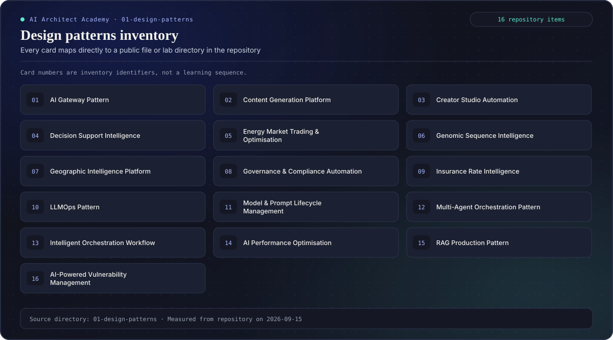
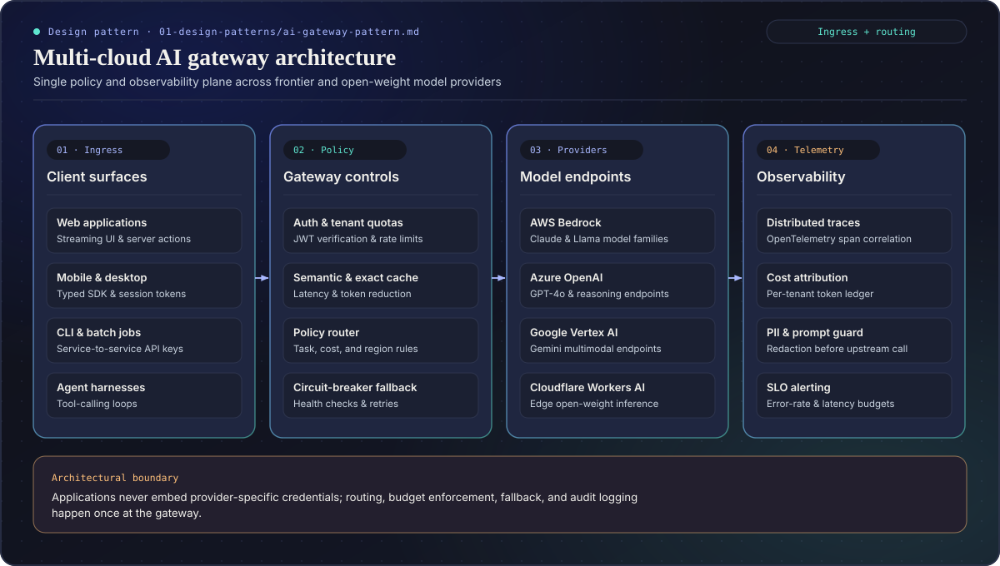
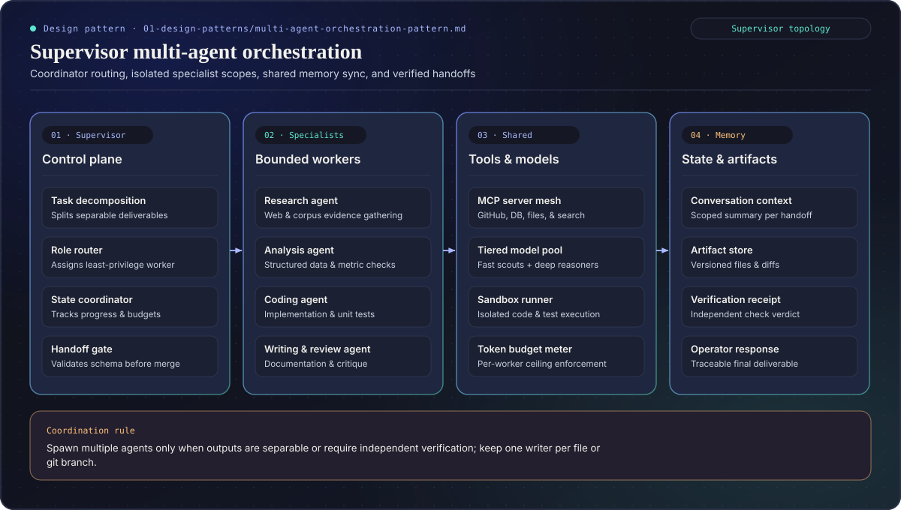
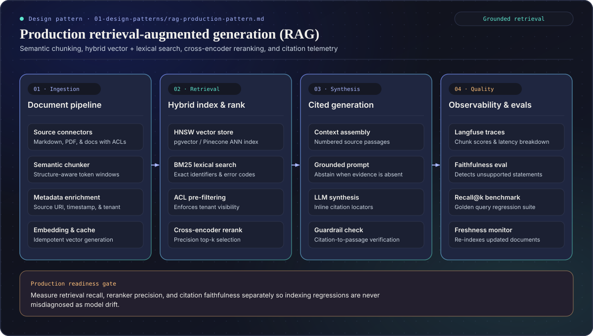

# Design Pattern Library
- **Customer Experience**: Content Generation, Language Understanding, Personalization, Conversational Commerce, Creator Studio Automation (new).
- **Decision Support & Workflow**: Decision Support Intelligence, Intelligent Orchestration Workflow, Predictive Operations, Autonomous Optimisation.
- **Platform Enablement**: Rapid Innovation, Security & Compliance Automation, Synthetic Data Generation for experimentation.
- **AI Infrastructure**: Multicloud Orchestration, Model Lifecycle Management, Governance & Compliance Automation, AI Performance Optimisation.
- **Industry Blueprints**: Insurance Rate Intelligence, Energy Trading Optimisation, Cyber Vulnerability Management, Genomic Analytics, GIS Intelligence.

Each pattern now includes:
1. **Mission & Use Cases** with measurable KPIs.
2. **Experience Blueprint** mapping human + agent actions.
3. **Technical Architecture Stack** aligned with CoE BOMs.
4. **Implementation Sprints** and **Agent Build Instructions** for rapid prototyping.
5. **Evaluation, Governance, and Deliverables** referencing reusable templates.

### How to Use
- Start with the pattern that matches your customer or internal need.
- Open `process/agentic-prototyping-guide.md` to orchestrate build tasks.
- Pull supporting assets from `AI CoE Templates/` for architecture diagrams, BOMs, and guides.
- Use governance checklists under `08-governance/` to ensure compliance.
- Feed outputs back into persona dashboards and Projects saved views for visibility.

### Compiled Architecture Blueprints & Section Inventory

These vector diagrams are compiled deterministically from `site/data/curriculum.json` and `diagrams/d2/*.d2` via `site/scripts/compile-curriculum-diagrams.mjs`. The numbered curriculum cards are inventory identifiers, not a learning sequence:

#### Design patterns section inventory

#### Multi-cloud AI gateway pattern ([`ai-gateway-pattern.md`](./ai-gateway-pattern.md))

#### Supervisor multi-agent orchestration ([`multi-agent-orchestration-pattern.md`](./multi-agent-orchestration-pattern.md))

#### Production RAG architecture ([`rag-production-pattern.md`](./rag-production-pattern.md))

