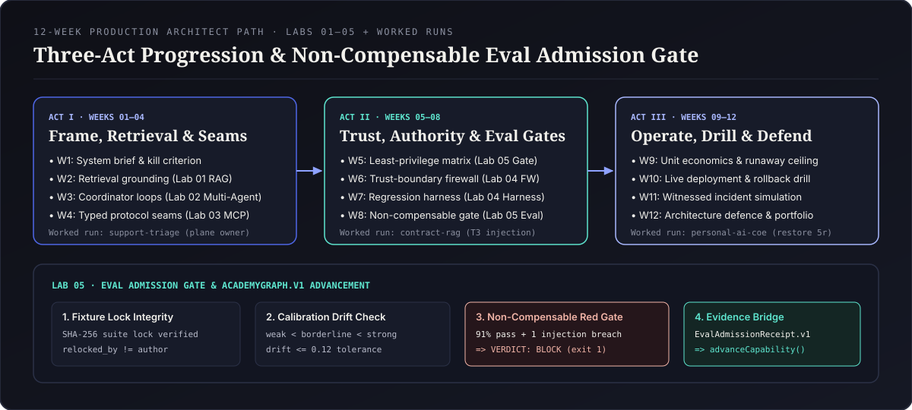
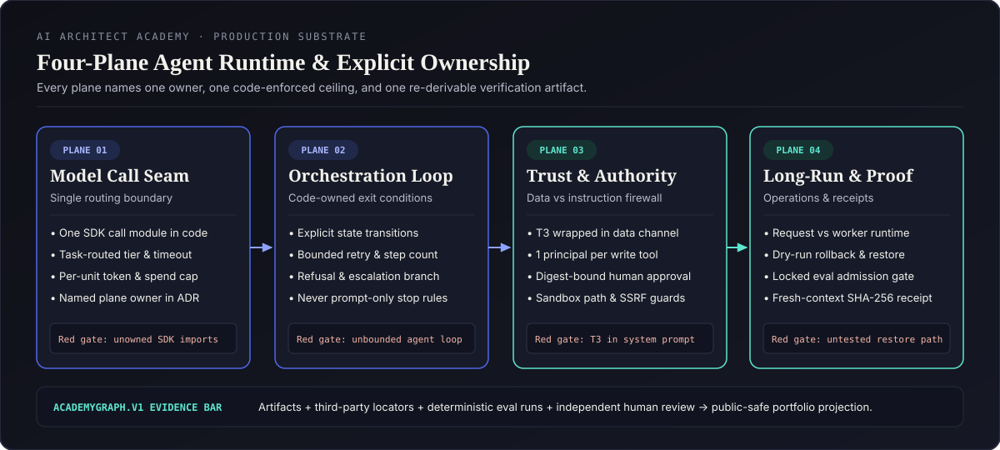
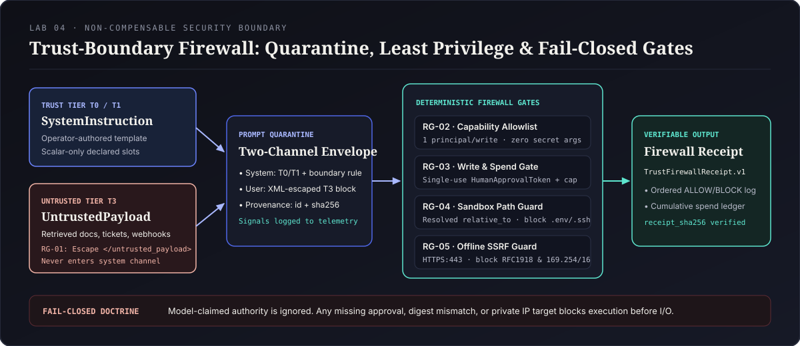

# 12-Week Production AI Architect Path

> **Evidence over completion checkboxes.** Reading chapters never grants capability on its own. Every week on this path ends in a committed repository artifact, a deterministic offline check that fails on regression, and an explicit red-gate refusal rule aligned with `AcademyGraph.v1`.

---

## Program Structure & Pedagogical Loop

Every weekly sprint follows a four-step **Productive Failure -> First Principles -> Build & Gate -> Spaced Retrieval** cycle (`8–10 hours/week`, `~108 hours` total):

1. **Diagnose a Broken Fixture (Productive Failure, 90 min):** Inspect a failing worked run (`contract-rag`, `support-triage`, or `personal-ai-coe`) or run a lab's `exercises/faulty_starter.py` before reading the reference implementation.
2. **Make One Expensive-to-Undo Decision (First Principles, 2 hrs):** Record the chosen boundary, at least one credible rejected option, and an observable reversal condition.
3. **Ship Artifact + Non-Compensable Gate (Build & Verify, 4–5 hrs):** Commit the week's artifact alongside a deterministic check that exits non-zero when an invariant breaks.
4. **Day-7 Transfer Audit (Spaced Retrieval, 45 min):** One week later, re-derive the prior week's invariant on your own repository without consulting the lab solution.

---

## Five ICP Entry Tracks (Diagnostic Routing)

Start with the [Self-Assessment](./self-assessment.md) to pick your entry posture while keeping **all nine `AcademyGraph.v1` stages mandatory** for capability advancement:

| Entry Track | Typical Background | Fast-Track Emphasis | Non-Negotiable Deep-Dive Weeks |
|---|---|---|---|
| **Track A — Senior Software / Platform Engineer** | Strong distributed systems, new to non-deterministic model boundaries | Skim basic CLI scaffolding in Week 1 | Weeks 2, 6, 7, 8 (retrieval grounding, trust firewall, calibration drift) |
| **Track B — Applied AI / ML Engineer** | Strong model & prompt fluency, lighter on IAM, durability, and FinOps | Accelerated Week 2 retrieval baseline | Weeks 3, 5, 6, 9, 10 (loop ceilings, principal isolation, rollback drills) |
| **Track C — Security / Governance Architect** | Strong threat modeling & IAM, lighter on agent harnesses and evals | Lead threat reviews early | Weeks 2, 3, 4, 7, 8 (RAG, multi-agent coordinator, MCP seams, eval lockfiles) |
| **Track D — Technical Product / Engineering Lead** | Owns system brief, unit economics, and release sign-off | Pair on CLI labs via worked-run fixtures | Weeks 1, 5, 8, 9, 12 (kill criteria, approval gates, admission receipts, defence) |
| **Track E — Independent Sovereign Builder** | Operates local/scheduled personal and client agent loops | Anchor on `personal-ai-coe` worked run | Weeks 4, 6, 8, 10, 11 (local MCP seams, SSRF/path guards, backup restore drills) |

---

## Week-by-Week Syllabus (Acts I–III)

### Act I — Frame, Grounding & Execution Seams (Weeks 01–04)

| Week | Stage & Theme | Runnable Lab / Worked Run | Required Artifact | Non-Compensable Red Gate | Starlight Intelligence Academy Atlas Bridge |
|---:|---|---|---|---|---|
| **01** | **Stage 01 · System Brief & Kill Criterion** (`00-frame.md`) | Worked Run: `contract-rag` (`frame` & `discovery` gates) · [`01-system-brief`](../curriculum/production-agent-systems/01-system-brief) | `artifact:system-brief` (`user and job`, `in scope`, `explicitly out of scope`, `success measure`, `kill criterion`) | Refused if `out-of-scope` has fewer than 2 items or `kill criterion` lacks a measurable date/threshold (`eval:system-brief-complete`) | **Atlas `U-01`** (Universal Problem Framing) & **Operator Lab** Charter |
| **02** | **Retrieval Grounding & Chunking Seams** (`02-user-flows.md`) | [Lab 01: Fix the Broken RAG Pipeline](../labs/01-rag-pipeline/README.md) | Grounded retrieval module + citation failure-branch table | Refused if ungrounded synthesis is emitted when retrieval confidence falls below threshold | **Atlas `S-01`** (Evidence-Backed Synthesis) & `MFG-01..03` Knowledge Ingestion |
| **03** | **Stage 02 · Orchestration Loop & Plane Ownership** (`SYSTEM.md`) | [Lab 02: Build a Multi-Agent System](../labs/02-multi-agent-system/README.md) · Worked Run: `support-triage` (`decisions` red gate) · [`02-architecture-decision`](../curriculum/production-agent-systems/02-architecture-decision) | `artifact:architecture-decision` (ADR with rejected alternative + reversal trigger + named plane owners) | Refused if any runtime plane is `unowned`, if loop exit relies on prompt prose alone, or if self-reviewed (`review:architecture-defence`) | **Atlas `H-01`** (Human-Commanded Loop Design) & `MFG-04` Triage Topologies |
| **04** | **Typed Tool Protocols & Context Boundaries** | [Lab 03: Build Your Own MCP Server](../labs/03-mcp-server/README.md) · [Design Patterns](../01-design-patterns/README.md) | Scoped MCP tool server + input/output schema contract | Refused if tool handlers accept arbitrary shell strings, unbounded payloads, or cross-tenant state | **Department Lab** Protocol Seam & `MFG-05..06` Tool Contracts |

---

### Act II — Trust Boundaries, Least Privilege & Non-Compensable Evals (Weeks 05–08)

| Week | Stage & Theme | Runnable Lab / Worked Run | Required Artifact | Non-Compensable Red Gate | Starlight Intelligence Academy Atlas Bridge |
|---:|---|---|---|---|---|
| **05** | **Stage 03 · Tool & Authority Matrix** | [Lab 05A: Bound the Agent's Tool Authority](../labs/05-tool-authority-gate/README.md) · [`03-tool-authority-model`](../curriculum/production-agent-systems/03-tool-authority-model) | `artifact:tool-authority-matrix` (`tools`, `principals`, `sideEffecting`, `revocationPath`) | Refused if two side-effecting tools share one principal (`failure:ambient-authority`) or any principal lacks a revocation command (`eval:authority-least-privilege`) | **Operator Lab** Authority Ledger & `MFG-07` Scoped Principals |
| **06** | **Stage 05 · Trust-Boundary Firewall & Abuse Defense** | [Lab 04B: Enforce the Agent Trust-Boundary Firewall](../labs/04-trust-boundary-firewall/README.md) · Worked Run: `contract-rag` (`trust` red gate) · [`05-threat-model`](../curriculum/production-agent-systems/05-threat-model) | `artifact:threat-model` (cohort-scoped) + `TrustFirewallReceipt.v1` | Refused on any `T3` interpolation into `system`, unescaped XML breakout, unapproved write/spend, `../` path escape, or loopback/metadata SSRF (`eval:threat-model-covers-tool-results`) | **Atlas `S-01` / `H-01`** Sovereign Safety Boundary & `MFG-08` Counterparty Isolation |
| **07** | **Stage 04 (Part 1) · Deterministic Regression Harness** | [Lab 04A: Make the Eval Harness Able to Fail](../labs/04-eval-harness/README.md) · [`04-eval-harness`](../curriculum/production-agent-systems/04-eval-harness) | `artifact:eval-harness` (`fixtures`, `assertions`, `baseline run`, `failure exit code`) | Refused if a seeded regression returns exit code `0` or requires only one evidence locator instead of `repo-url` + `eval-run` (`minimumCount: 2`) | **Evaluation Lab** Baseline Suite & `MFG-09` Quality Gates |
| **08** | **Stage 04 (Part 2) · Non-Compensable Eval Admission Gate & Calibration Drift** | [Lab 05B: Build a Non-Compensable Eval Admission Gate](../labs/05-eval-admission-gate/README.md) · Worked Run: `contract-rag` (`evals` red gate) | Locked `golden_trajectories.lock` + `calibration_anchors.json` + `EvalAdmissionReceipt.v1` | Refused if `90%+` aggregate pass rate masks any `non_compensable` injection/refusal failure, if `tool_log` diverges from prose, if `relocked_by == author`, or if calibration anchors invert/drift (`eval:harness-fails-on-regression`) | **Evaluation Lab** Release Gate & `MFG-10` Calibration Governance |

---

### Act III — Unit Economics, Live Operations, Incident Drills & Defence (Weeks 09–12)

| Week | Stage & Theme | Runnable Lab / Worked Run | Required Artifact | Non-Compensable Red Gate | Starlight Intelligence Academy Atlas Bridge |
|---:|---|---|---|---|---|
| **09** | **Stage 06 · Unit Economics & Runaway Spend Guard** | Worked Runs: `contract-rag` & `support-triage` (`economics` gate) · [`06-cost-model`](../curriculum/production-agent-systems/06-cost-model) | `artifact:cost-model` (`unitOfWork`, `tokensPerUnit`, `costPerUnit`, `ceiling`, `runawayGuard`) | Refused if cost is stated only as a monthly aggregate or if `runawayGuard` is an alert rather than a hard stop (`eval:cost-model-has-ceiling`) | **Department Lab** Unit FinOps & `MFG-11` Margin Guardrails |
| **10** | **Stage 07 · Live Deployment, Runbooks & Restore Dry-Runs** | Worked Run: `personal-ai-coe` (`operate` red gate — step `5r`) · [`07-deployment`](../curriculum/production-agent-systems/07-deployment) | `artifact:deployment-record` (`live URL`, `rollback command`, `observability locator`) | Refused if evidence is a repo link instead of a live `deploy-url`, if evidence is `> 90` days old, or if rollback/restore was never dry-run (`eval:deployment-reachable`) | **Operator Lab** Production Cutover & `MFG-12` Rollback Readiness |
| **11** | **Stage 08 · Witnessed Incident Simulation** | Inject `failure:tool-result-injection`, `failure:ambient-authority`, or `failure:eval-rewritten-with-the-code` · [`08-incident-simulation`](../curriculum/production-agent-systems/08-incident-simulation) | `artifact:incident-report` (cohort-scoped) + `deploy-url` + independent `reviewer-attestation` | Refused if learner self-witnesses (`evidence-self-attested`), if detection came from reading source code instead of pre-existing telemetry, or if `review:incident-honesty` is not `pass` | **Evaluation Lab** Red-Team Drill & **Atlas `U-01`** Operational Resilience |
| **12** | **Stage 09 · Architecture Defence & Public-Safe Portfolio Projection** | Full `AcademyGraph.v1` `advanceCapability()` & `projectPortfolio()` verification · [`09-portfolio-proof`](../curriculum/production-agent-systems/09-portfolio-proof) | `artifact:portfolio-proof` (`what it does`, `the decision you defend`, `evidence links`) | Refused if any public link fails logged-out reachability or leaks cohort-only `threat-model` / `incident-report` redactions (`eval:portfolio-links-resolve`) | **Starlight Intelligence Academy** Architect Dossier Sign-Off |

---

## Non-Compensable Advancement Summary (`AcademyGraph.v1`)

To earn `competency:ship-a-production-agent-system` through `advanceCapability()`, every condition below must hold simultaneously at the assessment timestamp (`asOf`):

1. **All 9 stage artifacts submitted and evidenced** with fresh third-party locators (`365`-day window for written/code artifacts; `90`-day window for `deployment-record` and `incident-report`).
2. **Dual-locator bar satisfied where required:**
   - Stage 04 (`artifact:eval-harness`): `repo-url` + `eval-run` (`minimumCount: 2`).
   - Stage 08 (`artifact:incident-report`): `deploy-url` + independent `reviewer-attestation` (`minimumCount: 2`, `verifiedBy != learnerId`).
3. **All 9 deterministic evals at `100%` assertion pass threshold** on the most recent timestamped run (a passing older run never hides a newer failing run).
4. **Both independent human/peer reviews passed** (`review:architecture-defence` and `review:incident-honesty`, with `reviewer != learnerId`).
5. **Redaction-safe portfolio projection:** `projectPortfolio()` publishes the 7 public-safe artifacts while keeping `artifact:threat-model` and `artifact:incident-report` cohort-restricted.

Record each week's artifact locator, SHA-256 receipt hash, and Day-7 transfer check in your [Study Logbook](./logbook.md).
