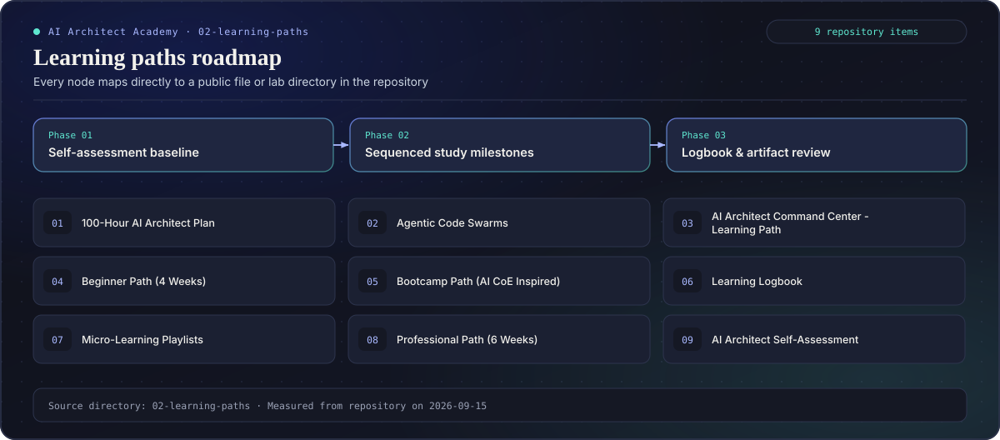
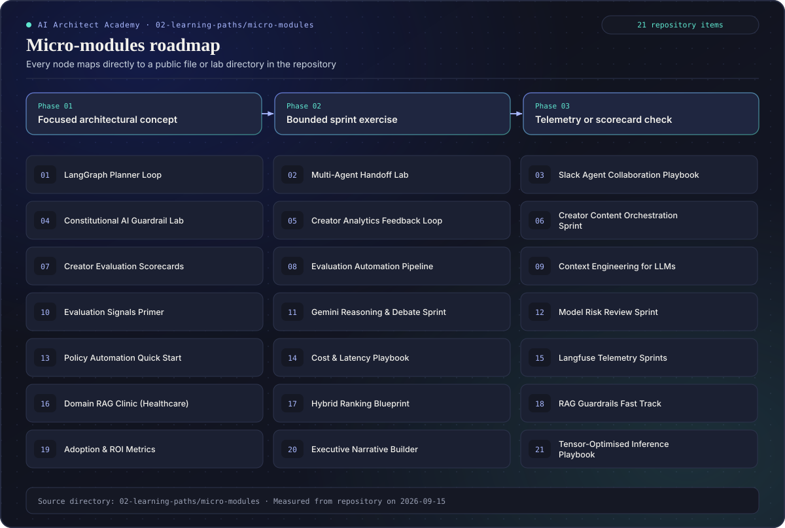
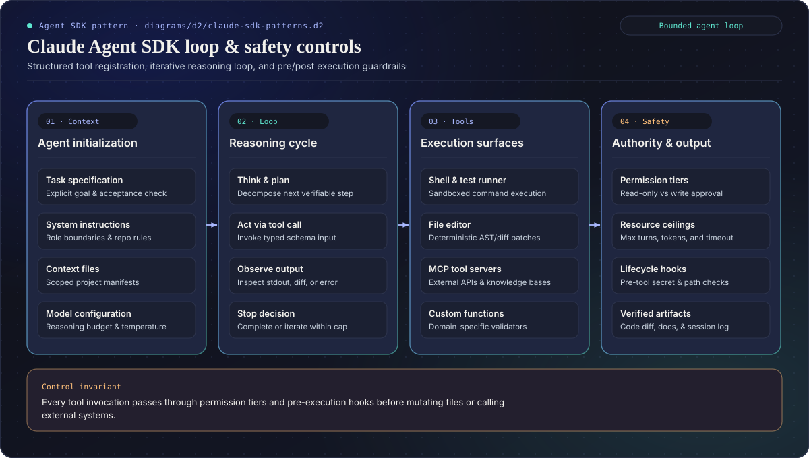
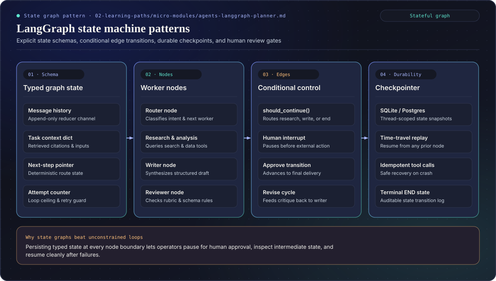
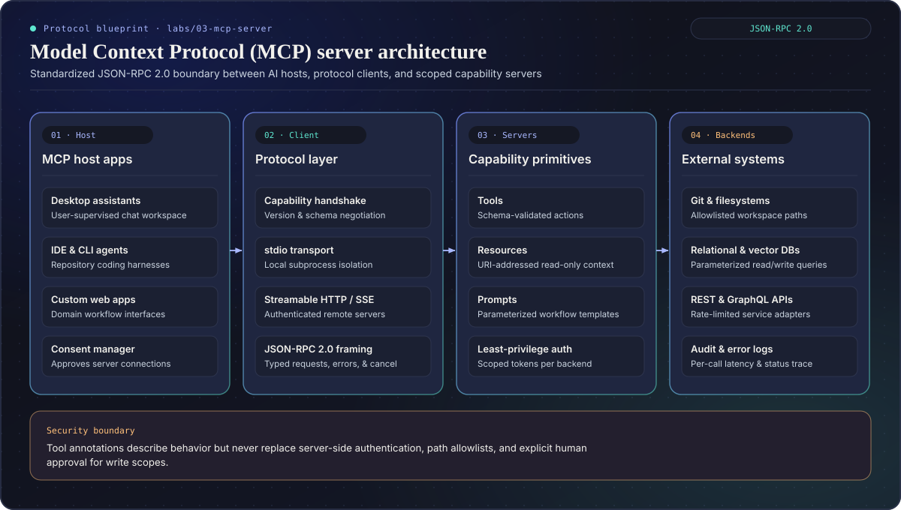

# Learning Paths & Agentic Architecture Blueprints

Structured study tracks and micro-module progressions across the AI Architect Academy repository, paired with compiled vector roadmaps and agent harness blueprints.

## Study Tracks in This Directory

- [Self-Assessment](./self-assessment.md) — baseline architecture diagnostic before choosing a track
- [Beginner Track](./beginner.md) — core model, retrieval, and system boundary fundamentals
- [Bootcamp Track](./bootcamp.md) — intensive implementation milestones with runnable labs
- [100-Hour AI Architect](./100-hour-ai-architect.md) — structured long-horizon study plan
- [Professional Track](./professional.md) — production governance, evaluation harnesses, and architecture reviews
- [Agentic Code Swarms](./agentic-code-swarms.md) — multi-agent coding workflows, worktree isolation, and review gates
- [AI Architect Command Center](./ai-architect-command-center.md) — workspace setup and telemetry conventions
- [Micro-Learning Index](./micro-learning.md) — focused concept-and-exercise sprints in [`micro-modules/`](./micro-modules)
- [Study Logbook](./logbook.md) — artifact and architecture decision log template

## Compiled Learning Path Roadmaps

Generated deterministically from `site/data/curriculum.json` via `site/scripts/compile-curriculum-diagrams.mjs`:

### Learning paths section roadmap

### Micro-modules section roadmap

## Agent Harness & Protocol Blueprints

### Claude Agent SDK patterns

### LangGraph stateful workflows

### Model Context Protocol (MCP) architecture

