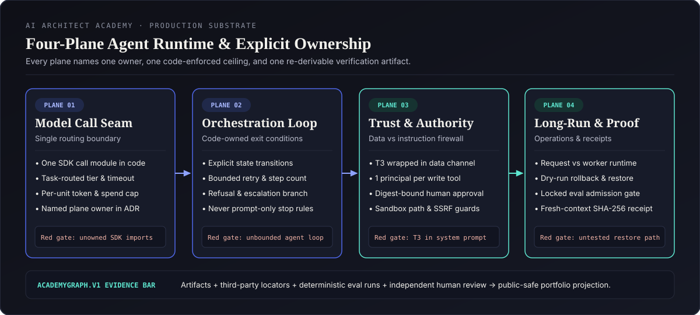
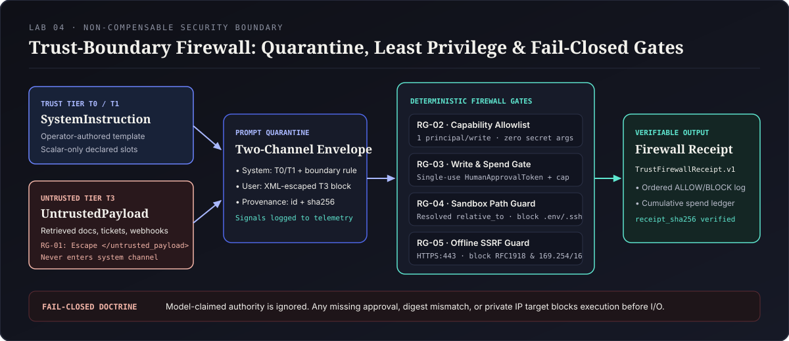
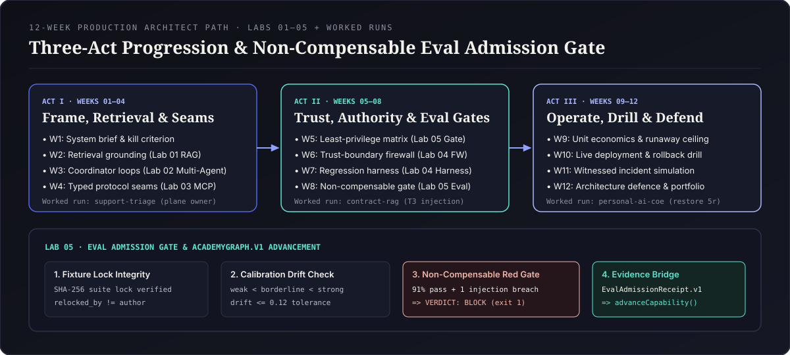

<p align="center">
  
</p>

<h1 align="center">AI Architect Academy</h1>

<p align="center">
  <strong>The world's first coding-agent-native learning platform.</strong><br/>
  Learn AI architecture by building with an AI architect — inside your terminal.
</p>

<p align="center">
  <em>Independent project. Not affiliated with, endorsed by, or sponsored by Oracle.</em>
</p>

<p align="center">
  <a href="#quick-start"></a>
  <a href="#interactive-labs"></a>
  <a href="#skills-library"></a>
  <a href="#learning-paths"></a>
  <a href="LICENSE"></a>
</p>

<p align="center">
  
</p>

---

## What Makes This Different

```
Traditional course:     Read docs → Watch videos → Maybe build something
AI Architect Academy:   Clone repo → Open Claude Code → Build with an instructor
```

When you open this repo in [Claude Code](https://code.claude.com/docs), the agent becomes your **personal AI architecture instructor**. It knows your progress, guides you with questions (not answers), and reviews your work like a senior engineer.

**The medium is the message.** You learn to build AI systems by building AI systems — with an AI.

---

## Quick Start

```bash
# 1. Clone the academy
git clone https://github.com/frankxai/ai-architect-academy.git
cd ai-architect-academy

# 2. Open Claude Code
claude

# 3. Start learning
/academy
```

That's it. The instructor takes over from here.

---

## The Experience

When you launch Claude Code in this directory, you'll see:

```
Academy | 0/3 labs completed | Current: none | Type /academy for menu
```

Type `/start-lab 01` and the instructor begins:

```
╔══════════════════════════════════════════════════════════════╗
║  AI ARCHITECT ACADEMY — Lab Mode                            ║
║  Lab: Fix the Broken RAG Pipeline                           ║
║  Difficulty: Intermediate | Est. Time: 45m                  ║
╚══════════════════════════════════════════════════════════════╝

Welcome, Architect.

Your company's customer support AI is returning irrelevant answers.
The RAG pipeline is live but broken. There are 3 bugs in rag_pipeline.py.

Before I guide you — take a look at the code. What do you notice about
the chunk_documents() method?
```

The instructor uses **Socratic method** — it asks questions, not gives answers. When you're stuck, type `/hint` for incremental clues. When ready, type `/review` for an architect-grade code review.

---

## Interactive Labs

| Lab | What You Build | Difficulty | Time |
|-----|---------------|-----------|------|
| **[01: Fix the Broken RAG Pipeline](labs/01-rag-pipeline/README.md)** | Debug chunking, search, and context assembly in a production RAG system | Intermediate | 45m |
| **[02: Build a Multi-Agent System](labs/02-multi-agent-system/README.md)** | Implement a coordinator that orchestrates Researcher, Analyst, and Writer agents | Advanced | 60m |
| **[03: Build Your Own MCP Server](labs/03-mcp-server/README.md)** | Create a TypeScript MCP server with 3 tools for Claude Code | Advanced | 60m |
| **[04A: Make the Eval Harness Able to Fail](labs/04-eval-harness/README.md)** | Harden an evaluation runner so seeded regressions exit non-zero | Intermediate | 60m |
| **[04B: Enforce the Trust-Boundary Firewall](labs/04-trust-boundary-firewall/README.md)** | Quarantine T3 payloads, enforce capability least privilege, gate spend, and block path/SSRF escapes offline | Advanced | 75m |
| **[05A: Bound the Agent's Tool Authority](labs/05-tool-authority-gate/README.md)** | Isolate one principal per write tool and verify revocation paths | Advanced | 75m |
| **[05B: Build an Eval Admission Gate](labs/05-eval-admission-gate/README.md)** | Enforce non-compensable red gates, fixture SHA-256 locks, and calibration drift checks | Advanced | 75m |

<p align="center">
  
</p>

Each lab includes:
- Real source code (broken or scaffolded)
- Test suites (your objective pass/fail gate)
- Sample data
- Checkpoints tracked in your progress file

---

## Commands

| Command | What It Does |
|---------|-------------|
| `/academy` | Main menu — see everything available |
| `/start-lab 01` | Begin (or resume) an interactive lab |
| `/hint` | Get a Socratic hint — direction, not answers |
| `/review` | Architect review: tests + score + feedback |
| `/next` | Context-aware "what should I do next?" |
| `/progress` | Your full progress dashboard |
| `/solution` | Reveal the solution (requires prior attempt) |

### Architecture Skills

| Command | What It Does |
|---------|-------------|
| `/design-solution` | End-to-end AI solution architecture |
| `/build-rag` | Build a RAG system from scratch |
| `/mcp-server` | Build a custom MCP server |
| `/security-review` | Security assessment |
| `/optimize-costs` | Cost optimization analysis |

---

## How It Works (Architecture)

```
ai-architect-academy/
├── CLAUDE.md                    # Instructor Engine — persona, rules, curriculum state
├── .academy/
│   └── progress.json            # Your progress (gitignored, personal to you)
├── .claude/
│   ├── commands/                # /hint, /review, /next, /academy, etc.
│   ├── hooks/                   # Session-start welcome, progress tracking
│   └── skill-rules.json         # Auto-activation rules for 23 skills
├── labs/                        # Interactive coding labs (offline test gates)
│   ├── 01-rag-pipeline/         # Python — fix broken RAG (3 bugs)
│   ├── 02-multi-agent-system/   # Python — build coordinator pattern
│   ├── 03-mcp-server/           # TypeScript — build MCP server
│   ├── 04-eval-harness/         # Python — make the eval harness able to fail
│   ├── 04-trust-boundary-firewall/ # Python — T3 quarantine, spend gate & SSRF firewall
│   ├── 05-tool-authority-gate/  # Python — bound tool principals & revocations
│   └── 05-eval-admission-gate/  # Python — non-compensable eval gate & drift lock
├── claude-ai-architect/         # Knowledge base + 23 expert skills
│   ├── skills/                  # RAG, MCP, multi-cloud, security, etc.
│   ├── knowledge-base/          # OCI GenAI, infrastructure docs
│   ├── templates/               # D2 diagrams, Terraform modules
│   └── saas-curriculum/         # 12-week structured curriculum
├── 01-design-patterns/          # 20+ architecture patterns
├── 02-learning-paths/           # Structured learning tracks
├── 03-awesome/                  # Curated resources and examples
└── 05-projects/                 # 100+ project ideas
```

### The Three Layers

1. **Instructor Engine** (`CLAUDE.md`) — Defines the teaching persona, Socratic rules, skill activation, and progress tracking. This is what turns Claude from a generic assistant into a domain-expert instructor.

2. **Interactive Labs** (`labs/`) — Real codebases with real bugs and real test suites. The student writes code. The instructor guides. Tests are the judge.

3. **Knowledge Base** (`claude-ai-architect/skills/`) — 23 deep-dive skills that auto-activate based on context. Working on RAG? The RAG skill loads. Building an MCP server? The MCP patterns load.

---

## 🗺️ Start Here

<p align="center">
  
</p>

---

## 🎓 Learning Paths

Start with the flagship **[12-Week Production AI Architect Path](02-learning-paths/12-week-production-architect.md)** (mapping Weeks 1–12 across Labs 01–05, worked-run failure traces, non-compensable red gates, and `AcademyGraph.v1` portfolio advancement), or choose a focused track in [02-learning-paths/](02-learning-paths/README.md):

<p align="center">
  
</p>

| Path | Hours | Focus |
|------|-------|-------|
| **[12-Week Production Architect](02-learning-paths/12-week-production-architect.md)** | 108h | End-to-end production systems, Labs 01–05, worked runs & red-gate receipts |
| **Foundation** | 20h | Claude SDK, MCP basics, first agent |
| **Agent Developer** | 40h | Multi-agent, RAG, orchestration |
| **Multi-Cloud** | 40h | OCI, AWS, Azure, GCP patterns |
| **Enterprise Lead** | 30h | Security, governance, compliance |
| **Bootcamp** | 40h | Intensive: all labs + capstone |

---

## 🧩 Patterns

Explore [01-design-patterns/](01-design-patterns/) for 20+ architecture blueprints covering Customer Experience, Decision Support, Platform Enablement, and more.

---

## 🚀 Projects

Browse [05-projects/](05-projects/) to find 100+ practical builds for AI Architects, ranging from beginner RAG setups to advanced multi-agent orchestrations.

---

## 🌟 Awesome

Check out [03-awesome/](03-awesome/) for curated resources, agent aggregators, vector DB benchmarks, and portfolio examples to model.

---

## Skills Library (23)

Auto-activated by context. You never need to load them manually.

| Category | Count | Examples |
|----------|-------|---------|
| Agent Frameworks | 6 | Claude SDK, Oracle ADK, Oracle Agent Spec, LangGraph, OpenAI Agent Kit, Agentic Orchestration |
| Multi-Cloud AI | 7 | OCI, AWS, Azure, NVIDIA NIM, Kubernetes, Terraform, Multi-Cloud Architect |
| MCP & Integration | 2 | MCP architecture, MCP 2025 patterns |
| RAG & Knowledge | 1 | RAG expert |
| Enterprise & Security | 3 | AI security, enterprise AI patterns, GenAI DAC specialist |
| Evaluation & Production | 4 | Architecture diagramming, FinOps for AI, HuggingFace trainer, knowledge updater |

---

## Built With

- [Claude Code](https://code.claude.com/docs) — The agent runtime
- [Model Context Protocol](https://modelcontextprotocol.io/) — Tool integration standard
- ACOS patterns — Skill activation, hooks, and progress tracking adapted from the [Agentic Creator OS](https://github.com/frankxai/agentic-creator-os)

---

## Contributing

PRs welcome. If you want to add a lab, create a `labs/[id]-[name]/` directory with:
- `.lab/config.json` — Lab metadata
- Source code (broken or scaffolded)
- `tests/` — Test suite
- `README.md` — Mission briefing

Before opening a PR, run the confidential-material audit locally: `node scripts/audit-confidential.mjs`. It also runs in CI on every push and pull request (`.github/workflows/confidential-audit.yml`).

---

<p align="center">
  <strong>Built by <a href="https://frankx.ai">FrankX</a></strong><br/>
  <sub>The era of watching videos to learn code is over. Build with agents.</sub>
</p>
