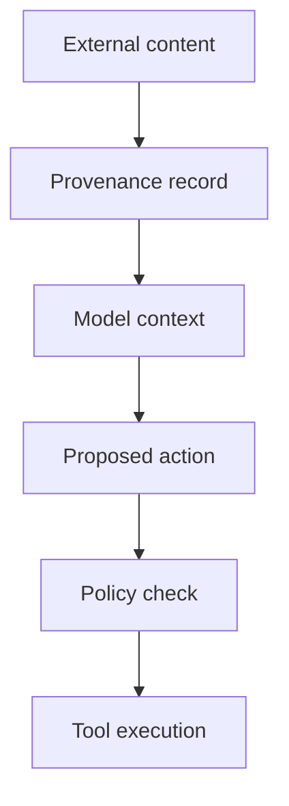
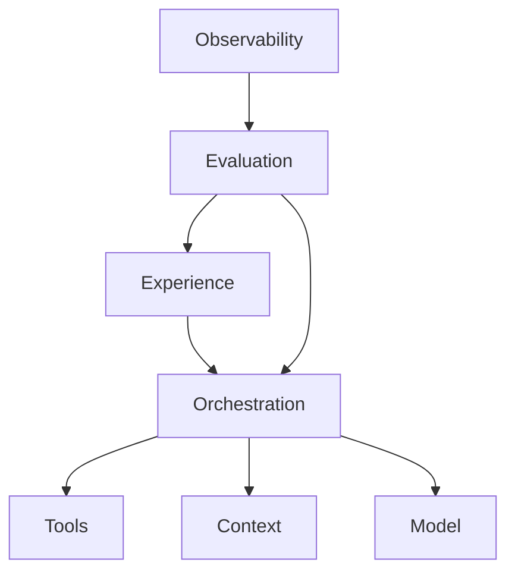
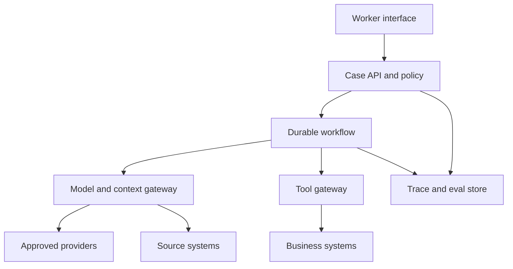
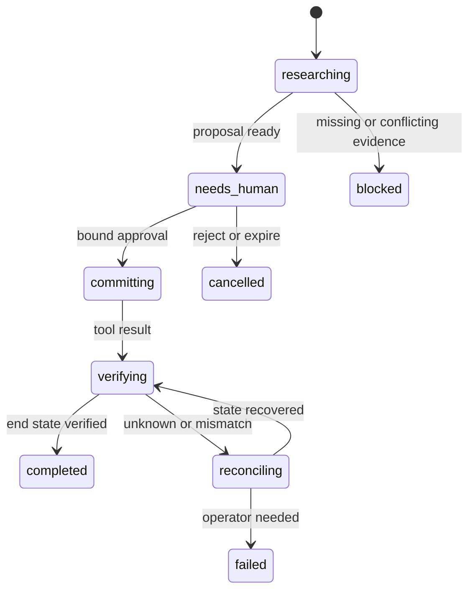

# AI Architect Guide 2026

**2026.0.7-working / working manuscript**

Accountable author: Frank Riemer. AI-assisted authorship is disclosed in the canonical contribution record. Author, specialist, rights and final-edition gates remain pending.

[Source revision e6b1e697b14abcf5ba2846817539747ae4037326](https://github.com/frankxai/ai-architect/tree/e6b1e697b14abcf5ba2846817539747ae4037326/guide). This export contains 23 manuscript files and 20579 counted prose words. Source review is partial and dated. No customer ROI, signed partnership, novelty or production outcome is implied.

# 00. Reading contract

AI Architect Guide 2026 is for people who already know how to ship software and have discovered that calling a capable model does not remove architecture work. It changes where the hard work sits.

The governing reader owns a production decision. You might be the architect deciding whether a claims workflow may call customer systems. You might be the CTO choosing between a fixed process and a tool-using agent. You might run an AI platform whose teams keep asking for a new model before they can state the outcome they need. This guide gives you a shared method for those decisions.

The method has two parts. Four decisions capture choices that become expensive after data, code, controls, and operating habits grow around them. Seven planes divide the running system into owned surfaces with evidence. The decisions say what must hold. The planes say who keeps it true.

That sounds spare because it is. The field already has enough catalogs.

## What you will be able to do

After working through the guide, you should be able to sit in an architecture review and ask, in order:

1. Where does provider-specific behavior stop?
2. What is the least autonomous loop that can handle the task?
3. Where can untrusted text influence a consequential action?
4. What owns state when the initiating request ends?
5. Who owns each operating plane, and what evidence does that owner produce?

Those questions force a team to expose decisions that a framework diagram often hides. They also survive product churn. On the verification date for this edition, vendor catalogs ranged from large reasoning models with million-token windows to cheap high-volume models, plus specialized voice, image, search, and tool surfaces. The names and prices will change. The boundary questions will remain useful. [S01](https://github.com/frankxai/ai-architect/blob/e6b1e697b14abcf5ba2846817539747ae4037326/guide/research/sources.yaml) [S02](https://github.com/frankxai/ai-architect/blob/e6b1e697b14abcf5ba2846817539747ae4037326/guide/research/sources.yaml) [S03](https://github.com/frankxai/ai-architect/blob/e6b1e697b14abcf5ba2846817539747ae4037326/guide/research/sources.yaml) [S04](https://github.com/frankxai/ai-architect/blob/e6b1e697b14abcf5ba2846817539747ae4037326/guide/research/sources.yaml)

## What this guide refuses

This guide will not rank vendors as a substitute for your evals. A public benchmark cannot know your task distribution, latency target, data policy, correction cost, or value per completed job.

It will not call every model loop an agent. A fixed workflow is often the right design. An agent earns autonomy when the task path cannot be specified in advance and the value can pay for the extra uncertainty. Anthropic draws a useful line between workflows with predefined paths and agents that direct their own tool use. OpenAI documents both model-led and code-led orchestration. [S05](https://github.com/frankxai/ai-architect/blob/e6b1e697b14abcf5ba2846817539747ae4037326/guide/research/sources.yaml) [S06](https://github.com/frankxai/ai-architect/blob/e6b1e697b14abcf5ba2846817539747ae4037326/guide/research/sources.yaml)

It will not treat a fluent answer as proof of an external action. A booking agent can say a seat was booked while the reservation table says otherwise. Agent evaluation has to inspect the transcript and the end state. [S15](https://github.com/frankxai/ai-architect/blob/e6b1e697b14abcf5ba2846817539747ae4037326/guide/research/sources.yaml)

This public working edition is unfinished. Automated checks and an isolated agent's source sample do not establish complete coverage or human expert certification. A named security reviewer, an independent final-edition verifier, and Frank Riemer still have to approve the final annual book. The open gates remain visible in the repository.

## How evidence works here

A source marker such as `S08` points to `research/sources.yaml`. A claim such as `C012` lives in `research/claims.yaml`. Facts report what a source says. Inferences state a conclusion drawn from facts. Prescriptions are Frank's rules for architecture work. They must carry a reason, a failure mode, and a test even when no standards body can prove them.

Treat dates as part of the claim. The model appendix was checked against vendor documentation on 2026-10-05. The EU AI Act source was reopened on that date; legal review remains pending. The MCP section cites the 2026-07-28 specification, and the A2A section cites version 1.0.0. Volatile claims have near-term review dates because memory is not evidence.

## The working agreement

Do not read this from front to back unless that helps you. Start with the four decisions. If one is open, use the matching lab. Then use the seven-plane matrix to expose ownership gaps. Read the plane chapters where evidence is missing.

The result should be a smaller set of stronger decisions, a test bank, a cost model, and a runbook. If all you get is a better diagram, the method has failed.


---

# 01. The architect's job

An AI architect bounds uncertainty so a useful system can run inside a known business, security, and operating envelope.

That definition matters because a language model introduces variation into a discipline built on repeatability. The same input may produce a different output. A tool call may be correct, unnecessary, or dangerous. Retrieved text can contain facts, stale instructions, malicious instructions, or all three. A run may last longer than the request that started it. A vendor may change a model, price, context limit, or product surface after the design review.

The architect cannot remove all of that variation. The job is to decide where variation is allowed, where code takes control, where a human must decide, and what evidence proves the boundary held.

## Architecture starts with consequences

Begin with the state that can change outside the model. A draft paragraph is reversible. Sending a payment, deleting a record, changing a price, filing a claim, granting access, or publishing advice can create a cost that survives the conversation.

This yields the first working rule:

> The required architecture grows with the cost of a wrong state change, not with the apparent intelligence of the model.

A fast model with one read-only search tool may need a small control surface. A cheaper model that can approve refunds across ten countries may need identity checks, policy versioning, deterministic limits, approval steps, idempotency, a full trace, and daily evaluation. Model prestige tells you little about that gap.

## Five uncertainties

A production design must bound at least five forms of uncertainty.

| Uncertainty | Question | Control evidence |
|---|---|---|
| capability | Can the selected model do this task on our cases? | capability and regression evals |
| information | Did the run receive the right facts at the right time? | source IDs, freshness, access result |
| action | Could the run call the right tool with the wrong authority? | tool contract, scope, policy decision |
| path | Can the loop wander, repeat, or delegate without limit? | state machine, step budget, stop reason |
| change | What happens when a model, policy, source, or tool changes? | version record, canary, rollback receipt |

These uncertainties move at different speeds. That is why a single “AI layer” on an enterprise diagram is weak. It groups together things with different owners, failure modes, and clocks.

## The decision half-life

Every architectural choice has a half-life: the period during which the evidence behind it stays useful.

A trust boundary may remain sound for years if its data classes and action classes stay stable. A model ranking can decay in weeks. A legal date can change through a new act or regulator decision. An eval dataset can age quietly as customers change how they ask for help.

Record the half-life as a review date. High-volatility facts get short review windows. Stable prescriptions get longer ones, but they still need counterexamples. This practice changes review meetings. Instead of asking whether an architecture is “done,” the team asks which evidence expires next.

## Control follows the risk

A useful control stack has four levels:

1. **Contract:** typed inputs, outputs, tools, scopes, and states.
2. **Policy:** rules that decide what may happen for this user, task, data class, and moment.
3. **Evidence:** traces, outcomes, test results, cost records, and approvals.
4. **Recovery:** cancellation, retry, compensation, rollback, and a named operator.

The model sits inside this stack. It does not own the stack.

MCP makes this distinction visible. Its specification exposes resources, prompts, and tools through a host-client-server design, yet it also warns that tools can open data and code-execution paths. It calls for explicit user control and says tool descriptions should be treated as untrusted unless the server is trusted. [S08](https://github.com/frankxai/ai-architect/blob/e6b1e697b14abcf5ba2846817539747ae4037326/guide/research/sources.yaml)

A2A makes a second distinction visible. It supports work between independent agent systems through discovery, messages, tasks, artifacts, streams, and asynchronous operations. The participating agents need not expose their internal state or tools. That is an interoperability boundary, not a reason to remove local policy checks. [S10](https://github.com/frankxai/ai-architect/blob/e6b1e697b14abcf5ba2846817539747ae4037326/guide/research/sources.yaml)

## Architecture as an evidence system

A diagram is useful when it tells an operator where to look after a bad run. Can they identify the exact model, context sources, tool arguments, policy result, state transition, outcome, cost, and approval? Can they reproduce the failure against a frozen case? Can they stop a replay from repeating the side effect?

If the answer is no, the diagram describes components while the architecture remains unproven.

This is the standard used throughout the guide. Every major decision ends in an artifact. Every artifact has an owner. Every owner produces evidence. Every consequential action has a recovery path.

That is how an AI system becomes operable rather than merely impressive.


---

# 02. Four hard-to-reverse decisions

Senior attention is scarce. Spend it on choices that become painful after the system grows around them.

The four decisions in this chapter are ordered by design, not by implementation sequence. A team may prototype a prompt before choosing its durable state store. The architecture review still has to force all four into the open before production.

## 1. The model-provider seam

The seam is the owned interface where provider-specific behavior stops.

It should cover the parts of model use that the rest of the product depends on: messages or responses, tool definitions, structured output, streaming, usage, errors, safety events, and trace identifiers. It should not pretend that every provider has identical semantics. A lowest-common-denominator wrapper can hide the very capability you need.

Use a two-part seam:

- a stable product contract above the seam;
- explicit provider adapters and capability flags below it.

The product contract might ask for `extract_claim`, `draft_reply`, or `plan_research` rather than a vendor model name. The adapter may map that task to a model, reasoning setting, tool format, timeout, and retry rule. Contract tests run against every approved adapter.

The failure mode is provider behavior leaking through many call sites. Migration then becomes a search-and-rewrite project, and a small API change can alter the whole product.

The verification test is concrete: run a representative eval slice against a second provider or a local fake adapter without changing product code above the seam. The result does not need parity. It must expose the capability, quality, cost, and behavior gap in one report.

Current catalogs justify the seam. OpenAI, Anthropic, Google, and xAI publish different families, context sizes, model states, tool surfaces, and prices. Those catalogs were already moving during 2026. [S01](https://github.com/frankxai/ai-architect/blob/e6b1e697b14abcf5ba2846817539747ae4037326/guide/research/sources.yaml) [S02](https://github.com/frankxai/ai-architect/blob/e6b1e697b14abcf5ba2846817539747ae4037326/guide/research/sources.yaml) [S03](https://github.com/frankxai/ai-architect/blob/e6b1e697b14abcf5ba2846817539747ae4037326/guide/research/sources.yaml) [S04](https://github.com/frankxai/ai-architect/blob/e6b1e697b14abcf5ba2846817539747ae4037326/guide/research/sources.yaml)

## 2. The loop shape

The loop shape decides who selects the next step.

Use four shapes:

| Shape | Next step chosen by | Good fit | Primary risk |
|---|---|---|---|
| fixed workflow | code | known path and known exceptions | brittle coverage |
| single agent loop | model within limits | open path, one coherent context | wandering or premature stop |
| parallel workers | coordinator plus independent workers | separable research or classification | cost and conflicting results |
| sequential specialists | explicit handoffs or staged calls | strong phase boundaries | context loss and error propagation |

Choose the least autonomous shape that can handle the task. OpenAI's Agents SDK documents model-led and code-led control, plus agents-as-tools, handoffs, chains, evaluator loops, and parallel runs. It notes that code-led orchestration is more predictable for speed, cost, and performance. [S06](https://github.com/frankxai/ai-architect/blob/e6b1e697b14abcf5ba2846817539747ae4037326/guide/research/sources.yaml)

Parallel agents are a budget decision. Anthropic reports that its research agents used about four times the tokens of chat interactions, while its multi-agent system used about fifteen times the tokens of chats in that workload. It also found that parallel agents fit high-value work with enough independent paths to justify the cost. [S21](https://github.com/frankxai/ai-architect/blob/e6b1e697b14abcf5ba2846817539747ae4037326/guide/research/sources.yaml)

The failure mode is autonomy by fashion. Teams split one coherent task across agents, pay the coordination tax, then add another model to judge the disagreements.

The verification test compares the chosen shape with the next simpler shape on the same task bank. Measure successful outcomes, p95 latency, tokens, tool calls, and human correction time. Keep the added autonomy only when it buys enough verified value.

## 3. The trust boundary

The trust boundary marks where text, identity, data, and tools meet authority.

Retrieved content is data. A webpage, ticket, PDF, email, chat log, tool description, memory record, or message from another agent may contain an instruction. That instruction has no authority merely because it entered the context window.

Trace the path from source to action:



The policy check sees the authenticated actor, purpose, data class, requested tool, arguments, scope, risk class, and approval state. High-impact tools use narrow credentials and explicit confirmation. A read token cannot become a write token because the model asks nicely.

The MCP authorization profile supplies useful transport controls: OAuth 2.1, protected resource metadata, resource indicators, least-privilege scope selection, issuer checks, and token audience validation. [S09](https://github.com/frankxai/ai-architect/blob/e6b1e697b14abcf5ba2846817539747ae4037326/guide/research/sources.yaml) These controls secure a request path. You still need product policy for the meaning of the action.

OWASP's 2026 agentic risk list names the broader failure family: goal hijack, tool misuse, identity and privilege abuse, poisoned components, unexpected code execution, memory poisoning, insecure agent messages, cascading failures, human trust exploitation, and rogue agents. [S18](https://github.com/frankxai/ai-architect/blob/e6b1e697b14abcf5ba2846817539747ae4037326/guide/research/sources.yaml)

The failure mode is a prompt boundary pretending to be a security boundary.

The verification test uses an injection case that enters through every untrusted source, asks for a forbidden side effect, and must fail closed. The trace must show the content source, rejected policy decision, absent tool execution, and user-safe explanation.

## 4. The long-run home

The long-run home owns state after the request, process, worker, or context window ends.

Any run that waits for approval, polls a source, calls several tools, crosses a timeout, or may be retried needs an explicit state machine. Store the goal, current step, prior results, policy state, budgets, idempotency keys, approvals, and stop reason outside the model transcript.

Durable workflow systems provide patterns for child work, parallel activity, callbacks, approval waits, long-running activity, retries, and continuing with fresh history. [S11](https://github.com/frankxai/ai-architect/blob/e6b1e697b14abcf5ba2846817539747ae4037326/guide/research/sources.yaml) Anthropic's long-running agent work adds a practical lesson: agents make steadier progress when each session leaves a clean state, an explicit progress record, and version history for the next session. [S12](https://github.com/frankxai/ai-architect/blob/e6b1e697b14abcf5ba2846817539747ae4037326/guide/research/sources.yaml)

The failure mode is treating a chat thread as the system of record. Compaction drops a detail, a worker restarts, or a webhook arrives twice. The agent either repeats an action or declares completion from stale context.

The verification test kills the worker after an irreversible tool returns but before the next step records completion. Restart the run. The side effect must occur once, the state must reconcile, and the operator must see why.

## The decision record

Each decision is either `MADE` or `OPEN`. A made decision names its owner and evidence. An open decision names the cost of waiting and a date.

When several decisions are open, fix trust first, then the long-run home, loop shape, and model seam. That order follows blast radius. A weak adapter creates migration work. A weak trust boundary can create a real incident.


---

# 03. Seven operating planes

The four decisions establish the skeleton. Seven planes divide the running system into surfaces that can be owned, measured, and changed.

A plane is not a product category. It is an operating contract. Each plane has inputs, outputs, state, service targets, budgets, security rules, evidence, and one accountable owner.

## The planes



The diagram shows dependency, not rank. Evaluation and observability cross the stack. Experience is included because user understanding, approval, correction, and recovery are production controls.

## 1. Model

The model plane owns capability supply. It selects approved models for task classes, controls provider adapters, pins versions where consistency matters, and measures quality, latency, refusal, and cost.

Its owner produces a model registry, routing policy, capability evals, regression results, and a rollback rule. A provider's public benchmark is input to research, never release evidence for your task.

## 2. Context

The context plane owns what the model can know during a run. It covers system instructions, examples, retrieved records, conversation history, memory, source provenance, data permissions, and freshness.

Its owner produces a context manifest for each run, retrieval tests, stale-data behavior, redaction checks, and citation evidence. Anthropic recommends tight context, clear tools with little functional overlap, and just-in-time retrieval for information that need not sit in the prompt. [S07](https://github.com/frankxai/ai-architect/blob/e6b1e697b14abcf5ba2846817539747ae4037326/guide/research/sources.yaml)

## 3. Tools

The tool plane owns the conversion from model intent to system effect. It defines schemas, authentication, scopes, validation, timeouts, idempotency, sandboxing, and result contracts.

Its owner produces a tool registry, threat model, contract tests, side-effect class, approval rule, and audit event. A tool is a privileged API surface with a natural-language caller. Treat it with the same care as any public endpoint, then add defenses for ambiguous intent.

## 4. Orchestration

The orchestration plane owns order, branching, delegation, state transitions, concurrency, budgets, retries, checkpoints, stop conditions, and recovery.

Its owner produces a state-machine description, failure table, run budget, replay test, and operator commands. It also proves why the chosen loop shape is worth its extra uncertainty.

## 5. Evaluation

The evaluation plane owns the definition of acceptable behavior. It turns production outcomes and failure cases into repeatable trials with deterministic checks, calibrated model rubrics, and human judgment.

Its owner produces task banks, environment fixtures, graders, thresholds, baselines, regression reports, and release verdicts. OpenAI recommends early, task-specific evals built from production-shaped data, with automated scoring and human calibration. [S13](https://github.com/frankxai/ai-architect/blob/e6b1e697b14abcf5ba2846817539747ae4037326/guide/research/sources.yaml)

## 6. Observability

The observability plane owns the record of what happened. It joins model, context, tool, policy, state, outcome, latency, cost, and user events under one trace.

Its owner produces a telemetry contract, redaction policy, retention rules, alerts, incident queries, and sampled trace reviews. OpenTelemetry now maintains GenAI conventions in a separate repository covering spans, metrics, events, MCP, and provider-specific signals. The work is still evolving, so pin the convention version you emit. [S16](https://github.com/frankxai/ai-architect/blob/e6b1e697b14abcf5ba2846817539747ae4037326/guide/research/sources.yaml)

## 7. Experience

The experience plane owns the human system around the run: intent capture, expectation setting, progress, source display, uncertainty, approval, correction, escalation, and recovery.

Its owner produces user flows with failure branches, approval copy, correction paths, accessibility checks, and behavior metrics. A hidden human gate is an operations defect. A vague confirmation dialog is a security defect.

## Cross-plane contracts

Most serious failures cross planes. A stale policy document enters through context, the model interprets it, orchestration routes to a refund tool, the tool holds a broad token, the interface presents a confident summary, and observability records only the final text. No single component appears broken. The system is.

For each boundary between planes, write a contract:

- model to context: accepted formats, size, source IDs, trust labels;
- model to tools: schema, confidence handling, validation, denied behavior;
- tools to orchestration: result states, retries, duplicate handling;
- orchestration to experience: progress, approval, stop, recovery;
- every plane to observability: required fields and redaction;
- evaluation to every plane: cases, assertions, and release thresholds.

## Ownership test

Ask each plane owner for the last piece of evidence they produced. If the answer is a roadmap, a slide, or another team's dashboard, ownership is nominal.

Real ownership can point to a current contract, a test, a runtime signal, a failure threshold, and a rollback action. The seven-plane matrix in the labs turns that standard into a one-page review.


---

# 04. Model plane: buy capability, keep the exit

The model plane supplies capability to a product contract. It should make a model easy to replace and hard to change by accident.

Those goals pull in different directions. Fast-moving teams want the newest model. Operators want repeatable behavior. Finance wants a lower unit cost. Security may restrict providers, regions, training terms, or tools. Product needs a quality level on real work. The plane owner turns those demands into a procurement and release process.

## Route tasks, not prestige

Define task classes before model routes. A useful task profile includes:

- user and business outcome;
- input and output modes;
- maximum context and output size;
- tool and structured-output needs;
- latency target;
- quality floor and forbidden failures;
- data, region, and retention limits;
- cost ceiling per successful task.

Then evaluate approved model candidates on that profile. The route may use one model, a cheap default with a harder-case route, or a small portfolio split by modality. Keep the route visible in configuration and traces.

A model router should not infer business risk from prompt length alone. A short request to delete a tenant can be riskier than a long request to summarize a public report. Route on task class, policy class, observed difficulty, and budget.

## Keep one provider seam

Place provider-specific request formats, tool encodings, streaming events, usage fields, error types, and version names behind one owned seam. Above it, expose product tasks and a normalized run record. Below it, keep explicit adapters.

Do not erase real differences. If one model supports a mode that matters, represent that as a capability flag and test the fallback. A fake universal interface becomes dangerous when it silently drops reasoning controls, tool constraints, citations, or safety events.

A good seam answers:

- Which feature is portable?
- Which feature is provider-specific?
- What happens when the feature is absent?
- Which eval protects the behavior?
- How long would migration take?

## Aliases for exploration, snapshots for proof

Vendor aliases can move to a newer release. Dated model IDs hold behavior more steadily. xAI's documentation, for example, distinguishes moving aliases from date-pinned releases and recommends the latter when consistency matters. [S04](https://github.com/frankxai/ai-architect/blob/e6b1e697b14abcf5ba2846817539747ae4037326/guide/research/sources.yaml)

Use moving aliases in discovery when the upside of fresh capability outweighs drift. Use a pinned model or recorded version for a production baseline, a regulated decision, or any result that must be reproduced. If a provider does not expose an immutable version, store the observed model ID and treat repeatability as limited.

Every model change needs a canary. Run capability cases to find gains, regression cases to protect known behavior, safety cases to test forbidden outcomes, and economics cases to catch cost or latency shifts. A global “better” model can still be worse on your tool schema or language mix.

## Price the successful outcome

Token price is only one term. Use this working formula:

`cost per success = (model + tools + infrastructure + review + failure recovery) / verified outcomes`

Long outputs, repeated tool calls, retries, evaluator calls, and human correction can dominate the headline model price. A model that costs more per token may cost less per successful task if it finishes in fewer turns with fewer corrections.

Track the distribution, not only the average. A small tail of looping runs can break the budget. Set per-run caps for tokens, time, tool calls, and attempts. Make the stop reason visible to the user and operator.

## Treat the 2026 catalog as dated data

The 2026-10-05 source review found changes in the named model families and prices since September. Appendix A holds the corrected rows. Account access, latency, and task performance require separate tests. [S01](https://github.com/frankxai/ai-architect/blob/e6b1e697b14abcf5ba2846817539747ae4037326/guide/research/sources.yaml) [S02](https://github.com/frankxai/ai-architect/blob/e6b1e697b14abcf5ba2846817539747ae4037326/guide/research/sources.yaml) [S03](https://github.com/frankxai/ai-architect/blob/e6b1e697b14abcf5ba2846817539747ae4037326/guide/research/sources.yaml) [S04](https://github.com/frankxai/ai-architect/blob/e6b1e697b14abcf5ba2846817539747ae4037326/guide/research/sources.yaml)

That snapshot belongs in Appendix A, outside the core method. The architectural conclusion is an inference: vendor facts decay too quickly to carry the product boundary.

## Release evidence

The model-plane owner should be able to provide:

1. the approved model registry and exact versions;
2. the route for each task class;
3. the last capability, regression, safety, and cost report;
4. a trace showing the actual model selected;
5. the fallback and rollback test;
6. the next source and eval review date.

If the only evidence is a vendor announcement or a benchmark screenshot, model selection has not become architecture yet.


---

# 05. Context plane: control what the model can know

The context plane decides which information enters a run, under which authority, for how long, and with what proof.

Context is often treated as a token-packing problem. Production failures make it a data and policy problem. The model may receive the wrong policy version, a record the user cannot access, a poisoned webpage, an old memory, too many similar tools, or a transcript that hides the one fact needed for the next step.

The plane owner must know the answer to a plain question: why was this item in the context?

## Build a context manifest

For each run, record a manifest with:

- system and policy versions;
- example-set version;
- user identity and purpose;
- source IDs and retrieval time;
- source owner and trust class;
- access-control decision;
- document or record version;
- memory items read or written;
- truncation or compaction events;
- final token counts.

This manifest is evidence for a run. It should join the trace without putting secrets into telemetry.

## Put stable rules up front, fetch changing facts late

Keep stable, high-authority rules close to the system boundary. Load changing facts when the task needs them. Anthropic describes this as tight context plus just-in-time retrieval, sometimes mixed with a small set of files or instructions loaded at the start. [S07](https://github.com/frankxai/ai-architect/blob/e6b1e697b14abcf5ba2846817539747ae4037326/guide/research/sources.yaml)

The split lowers two risks. First, stale facts do not sit in every prompt. Second, large collections do not crowd out the task. Runtime retrieval costs time, so low-latency work may preload a small, verified set and fetch the rest only on demand.

The test is a context ablation: remove one source family, instruction set, memory class, or example set and rerun the eval bank. If nothing changes, that context may be dead weight. If unrelated cases move, the item may be causing interference.

## Provenance before persuasion

A fluent source is not an authoritative source. Preserve source identity through chunking, ranking, summarization, and generation. A claim should point back to the exact record and version that supported it.

Retrieval needs failure behavior:

| Failure | Safe behavior |
|---|---|
| no source found | say the evidence is absent or route to a human |
| conflicting sources | expose the conflict and source dates |
| stale source | block or label based on task risk |
| access denied | do not reveal existence through phrasing or metadata |
| low-confidence match | fetch more or narrow the task |
| source contains instructions | keep them as quoted data, never grant authority |

A model-generated summary does not erase provenance. Store the source set and summary version. If the summary becomes long-lived memory, treat it as a new derived record with its own owner and expiry.

## Memory is state with a write policy

Memory can improve continuity, and it can preserve mistakes or attacks. Decide what may be written, who can read it, how it expires, and how a user can inspect or delete it.

Separate at least four classes:

1. user preference, such as response format;
2. task state, such as completed steps;
3. learned fact, such as an account constraint;
4. model reflection, such as a plan or summary.

These classes should not share the same trust level. Task state belongs in the long-run state machine. A model reflection is a hint, not a fact. A user preference cannot grant permission to a tool.

OWASP's 2026 agentic risks include memory and context poisoning, which can persist beyond the first malicious interaction. [S18](https://github.com/frankxai/ai-architect/blob/e6b1e697b14abcf5ba2846817539747ae4037326/guide/research/sources.yaml) Test delayed attacks: insert the malicious item in one run, then trigger the target action in a later run.

## Context budgets are quality budgets

Set budgets by function rather than one total number:

- policy and system rules;
- user and task input;
- examples;
- retrieved evidence;
- tool definitions and results;
- working history;
- reserved output.

When the budget is exceeded, use a declared policy: discard low-ranked evidence, summarize with source links, fetch later, or stop. Silent truncation turns quality failure into mystery.

## Release evidence

The context-plane owner should provide a manifest schema, access tests, freshness rules, retrieval evals, poisoning cases, memory-write rules, compaction tests, and a trace that reconstructs why every material source entered the run.

If an operator cannot answer which policy and records the model saw, the system cannot explain its own decision environment.


---

# 06. Tool plane: turn intent into controlled effect

The tool plane is where generated text gains consequences.

A tool contract has two audiences. Code needs a strict schema. The model needs a clear description of when the tool applies, what it cannot do, and what a result means. The security system needs identity, purpose, scope, policy, and an audit event. Treat all three as one product surface.

## One tool, one clear job

Tool overlap creates model confusion. Anthropic reports that large, ambiguous tool sets are a common failure source and recommends small tool sets with clear, self-contained purposes. [S07](https://github.com/frankxai/ai-architect/blob/e6b1e697b14abcf5ba2846817539747ae4037326/guide/research/sources.yaml)

Prefer `get_invoice`, `propose_refund`, and `commit_refund` over a generic `manage_account` tool. Separate read, proposal, and commit operations. The split gives policy and experience layers a place to inspect the pending action.

Each tool definition should include:

- a precise purpose and non-purpose;
- typed arguments with bounds;
- authenticated actor and tenant from trusted runtime state;
- side-effect class;
- required scope and policy;
- idempotency behavior;
- timeout and retry rules;
- result states, including partial and unknown;
- redaction rules;
- owner and runbook.

Never accept user or model text for a tenant ID, actor ID, or permission when the runtime already knows it.

## Protocol connection does not grant product authority

MCP standardizes how a host connects clients to servers that expose resources, prompts, and tools. The 2026-07-28 specification also adds negotiated extensions for long-running tasks, skills, and interactive apps. [S08](https://github.com/frankxai/ai-architect/blob/e6b1e697b14abcf5ba2846817539747ae4037326/guide/research/sources.yaml)

Use MCP to reduce custom connection work, then keep local policy. The MCP specification says tool descriptions should be treated as untrusted unless they come from a trusted server, and it calls for user consent before tool invocation. [S08](https://github.com/frankxai/ai-architect/blob/e6b1e697b14abcf5ba2846817539747ae4037326/guide/research/sources.yaml) A registry entry or signed package can raise confidence in origin. It does not prove that the tool is appropriate for this user or task.

For HTTP authorization, MCP defines an OAuth 2.1 profile with protected resource metadata, resource indicators, issuer validation, audience binding, and step-up scopes. [S09](https://github.com/frankxai/ai-architect/blob/e6b1e697b14abcf5ba2846817539747ae4037326/guide/research/sources.yaml) Apply the principle beyond MCP: issue narrow, short-lived credentials for one resource and purpose. Do not pass a broad backend token into the model process.

## Gate irreversible action

Classify tools by effect:

| Class | Example | Default control |
|---|---|---|
| read | fetch a public document | access check and trace |
| private read | fetch a customer record | identity, purpose, field filter |
| reversible write | save a draft | preview, undo, idempotency |
| consequential write | send, pay, publish, grant | explicit policy and human approval |
| destructive | delete, revoke, terminate | strong confirmation, delay or dual control |
| code or computer control | shell, browser, desktop | sandbox, allowlist, resource cap |

Human approval must bind to a concrete action. Show the target, material fields, effect, source, uncertainty, and expiry. “Allow agent to continue?” is too vague.

The approval token should be single-use and bound to the action digest. If arguments change, ask again.

## Make retries safe

A timeout does not tell you whether the remote action happened. Design for an `unknown` result. Use an idempotency key derived from the business action, store the request and response, query the remote state, then decide whether to retry or compensate.

Test the ugly point: the remote system commits, the network response is lost, and the worker restarts. The second attempt must return the first outcome or reconcile state without repeating the effect.

A2A 1.0.0 treats cancellation as idempotent and lets message handlers use message IDs to detect duplicates. Its webhook guidance calls for authenticity checks, retry backoff, SSRF defenses, idempotent processing, rate limits, HTTPS, and single-purpose tokens. [S10](https://github.com/frankxai/ai-architect/blob/e6b1e697b14abcf5ba2846817539747ae4037326/guide/research/sources.yaml) Those details are useful even when A2A is absent.

## Treat tool results as typed states

Do not collapse every result into prose. Return states such as:

```json
{
  "status": "committed",
  "operation_id": "refund_01J...",
  "idempotency_key": "tenant:claim:action",
  "policy_version": "refund-policy-18",
  "effect": {"currency": "EUR", "amount": 42},
  "observed_at": "2026-09-04T10:15:00Z"
}
```

Other states might be `denied`, `needs_approval`, `retryable`, `unknown`, and `compensated`. Orchestration can make a sound next-step decision only when result semantics are explicit.

## Test the caller, contract, policy, and effect

A tool test suite needs four layers:

1. schema and boundary tests;
2. authorization and policy tests;
3. adversarial model-caller tests;
4. end-state and replay tests.

Include indirect injection from every content source, argument smuggling, tenant swapping, scope escalation, tool-name confusion, malformed output, slow response, duplicate delivery, partial failure, and approval expiry.

## Release evidence

The tool-plane owner should provide the registry, side-effect class, schema, scope, policy version, threat model, injection cases, idempotency proof, approval flow, redaction rule, and operator command for each production tool.

A successful function call is not the standard. The standard is a permitted, correct, single effect with a trace and a recovery path.


---

# 07. Orchestration plane: choose the smallest useful loop

Orchestration decides what runs next, what state survives, how much work is allowed, and when the system stops.

The model can take part in that decision. It should not inherit unlimited control simply because the task contains uncertainty.

## Start with four shapes

### Fixed workflow

Code chooses the path. Models fill bounded steps such as classification, extraction, drafting, or comparison.

Use it when the business process and exceptions can be enumerated. It gives steady latency, clear ownership, and direct tests. Its weakness is brittle coverage when real tasks take paths the designer did not expect.

### Single agent loop

One model sees a goal, context, tools, and stop rules. It chooses actions until it returns an outcome or hits a limit.

Use it when the path is open but one context can hold the task. The loop needs step, token, time, and tool budgets. It also needs explicit stop reasons such as `completed`, `blocked`, `needs_human`, `budget_exhausted`, and `policy_denied`.

### Parallel workers

A coordinator splits independent work, then joins results. Research, broad search, independent scoring, and bulk classification can fit.

Parallel work buys breadth by spending more. Anthropic's research report measured about fifteen times the chat token use for its multi-agent system and notes that tasks with shared context or dense dependencies can be poor fits. [S21](https://github.com/frankxai/ai-architect/blob/e6b1e697b14abcf5ba2846817539747ae4037326/guide/research/sources.yaml)

### Sequential specialists

One specialist hands a typed artifact to the next. Examples include research to claim extraction to drafting to verification, or triage to a domain agent.

Use it when phase boundaries are real and each phase benefits from a focused context. Each handoff needs an artifact contract. Passing a conversational summary alone invites information loss.

## Let code own invariants

OpenAI documents both model-led and code-led orchestration. Code-led flow gives more predictable speed, cost, and performance, while model-led flow handles open tasks that need planning and tool choice. [S06](https://github.com/frankxai/ai-architect/blob/e6b1e697b14abcf5ba2846817539747ae4037326/guide/research/sources.yaml)

Keep hard invariants in code or policy:

- allowed transitions;
- budget ceilings;
- required approvals;
- tool and scope limits;
- idempotency;
- terminal states;
- tenant isolation;
- retention and redaction.

Let the model propose plans, choose among allowed actions, recover from descriptive tool errors, or ask for missing information. The runtime validates every proposal.

## Use protocols at the right boundary

MCP fits a host-to-capability boundary. A server exposes resources, prompts, and tools to a model application. [S08](https://github.com/frankxai/ai-architect/blob/e6b1e697b14abcf5ba2846817539747ae4037326/guide/research/sources.yaml)

A2A fits work between independent agent services. Version 1.0.0 supports capability discovery through Agent Cards, messages, tasks, artifacts, streaming, push updates, and long-running work without sharing internal state or tools. Its own specification describes MCP and A2A as complementary: an A2A server agent may call MCP tools to complete the delegated task. [S10](https://github.com/frankxai/ai-architect/blob/e6b1e697b14abcf5ba2846817539747ae4037326/guide/research/sources.yaml)

Do not add A2A for agents inside one process that already share code, identity, state, and deployment. An internal function or queue may be clearer. Use A2A when independent ownership, vendor separation, remote discovery, or cross-organization operation makes a protocol boundary valuable.

## Give long work a durable home

A model transcript is a record of conversation. It is a weak state machine.

Store orchestration state explicitly:

```yaml
run_id: run_01J...
goal_version: 7
state: awaiting_approval
current_step: commit_refund
attempt: 1
budget:
  tokens_remaining: 48000
  tool_calls_remaining: 6
policy_version: refund-policy-18
pending_action_digest: sha256:...
idempotency_key: tenant:claim:refund
checkpoint: s3://.../checkpoint-04.json
stop_reason: null
```

Durable systems supply patterns for retries, long-running activity, callbacks, approval waits, child work, and fresh histories. [S11](https://github.com/frankxai/ai-architect/blob/e6b1e697b14abcf5ba2846817539747ae4037326/guide/research/sources.yaml) The architectural prescription is broader than any product: if a run can outlive the request, give it an owned state machine, durable store, idempotency key, retry rule, and recovery path.

Anthropic's long-running agent experiments found that compaction alone did not preserve enough continuity. Better results came from incremental progress, a clean state at each handoff, progress records, version history, and explicit end-to-end tests. [S12](https://github.com/frankxai/ai-architect/blob/e6b1e697b14abcf5ba2846817539747ae4037326/guide/research/sources.yaml)

## Budget the path

Set an effort envelope before the run starts:

- maximum wall time;
- maximum model input and output tokens;
- maximum tool calls and retries;
- maximum concurrent workers;
- maximum spend;
- maximum unreviewed side-effect class.

The coordinator may spend within the envelope. It cannot rewrite the envelope. A budget increase is a policy event and may require a human.

Scale effort to task value and uncertainty. A lookup should not start ten workers. A high-value research task may justify them. Anthropic reports that explicit effort rules helped its coordinator avoid spending too much on simple queries. [S21](https://github.com/frankxai/ai-architect/blob/e6b1e697b14abcf5ba2846817539747ae4037326/guide/research/sources.yaml)

## Design failure as a state

For every step, define timeout, retry, duplicate behavior, compensation, operator action, and user message. Include `unknown` when the remote effect cannot be confirmed.

Test these events:

1. model call times out after consuming budget;
2. tool commits but response is lost;
3. worker dies before checkpoint;
4. approval arrives twice or after expiry;
5. child worker returns conflicting evidence;
6. policy changes while a run is paused;
7. cancellation arrives during a side effect;
8. the model declares success before the end state exists.

## Release evidence

The orchestration owner should provide a state diagram, transition table, budget policy, checkpoint format, idempotency test, failure injection report, cancellation behavior, replay command, and comparison with the next simpler loop shape.

Autonomy earns its place when the eval bank shows better verified outcomes at an acceptable total cost. Until then, extra loops are extra liability.


---

# 08. Evaluation plane: prove the outcome and the path

An agent can produce a polished answer, call the wrong tool, mutate the wrong record, and still look successful in a transcript.

The evaluation plane closes that gap. It defines a task, runs one or more trials in a controlled environment, records the path, checks the end state, and decides whether a change may ship.

## Start with the end state

Write the required state before writing the prompt. For a refund task, success might mean:

- the correct customer and invoice were selected;
- policy version 18 allowed the amount;
- one refund record exists for EUR 42;
- the customer received a confirmation;
- no secret or internal policy text entered the response.

The agent's final sentence is evidence of what it said. The database, external API, file tree, or user-visible artifact is evidence of what happened. Anthropic distinguishes a transcript from an outcome for this reason. [S15](https://github.com/frankxai/ai-architect/blob/e6b1e697b14abcf5ba2846817539747ae4037326/guide/research/sources.yaml)

## Grade four dimensions

A release bank should grade outcome, path, safety, and economics.

### Outcome

Did the intended business and user state exist at the end? Prefer deterministic assertions when the state can be queried. Use a model rubric for open writing quality only after a human has calibrated the rubric on real examples.

### Path

Did the run use allowed sources, models, tools, routes, scopes, and approvals? Trace grading can expose a wrong tool choice or misplaced handoff even when the final answer is acceptable. OpenAI recommends traces during behavioral debugging, then datasets and repeated eval runs when a team needs comparison over time. [S14](https://github.com/frankxai/ai-architect/blob/e6b1e697b14abcf5ba2846817539747ae4037326/guide/research/sources.yaml)

### Safety

Did forbidden states remain absent? Include injection, exfiltration, privilege escalation, cross-tenant access, dangerous code, duplicate side effects, stale policy, denied action, and refusal cases. A safety gate is binary when the consequence demands it.

### Economics

Did the run finish inside its time, token, tool, retry, review, and correction budget? Record cost per verified success, not cost per model call.

## Use mixed graders

Agent behavior has both crisp and subjective parts. Anthropic groups graders into code-based checks, model-based rubrics, and human judgment. Code checks are fast and repeatable; model rubrics handle open outputs but need human calibration; humans catch subtle task and source failures. [S15](https://github.com/frankxai/ai-architect/blob/e6b1e697b14abcf5ba2846817539747ae4037326/guide/research/sources.yaml)

A sensible order is:

1. deterministic end-state checks;
2. schema, static, and policy checks;
3. trace assertions for tools, routes, and budgets;
4. a calibrated rubric for qualities that code cannot judge;
5. human review for high-impact cases and grader drift.

Do not ask a model grader to judge facts it cannot see. Supply the source, expected state, rubric, and permitted variation. Record the grader model and version because the grader can drift too.

## Run trials, not anecdotes

Model output varies. Repeat each stochastic case enough times to reveal a distribution. Track pass rate, not one pass. A high-impact binary gate may require every trial to pass. A capability measure may accept a lower initial rate while the team improves it.

Separate two banks:

- **capability cases** are hard cases that reveal the current frontier;
- **regression cases** protect behavior the system already claims to handle.

Anthropic recommends that capability cases begin hard enough to create room for progress, while regression cases stay near a full pass rate. Cases can graduate from one bank to the other. [S15](https://github.com/frankxai/ai-architect/blob/e6b1e697b14abcf5ba2846817539747ae4037326/guide/research/sources.yaml)

## Shape the bank like production

OpenAI recommends task-specific evals, production-shaped data, early logging, automated scoring where possible, and continued human calibration. [S13](https://github.com/frankxai/ai-architect/blob/e6b1e697b14abcf5ba2846817539747ae4037326/guide/research/sources.yaml)

Sample by risk and frequency. Common tasks protect the core service. Rare costly failures deserve their own cases. Include languages, tenant types, data sizes, tool failures, policy versions, and human interruption patterns found in real traffic.

Mine incidents and corrections. Every material production failure should become a frozen case after secrets are removed. The case needs the triggering input, starting state, expected state, forbidden state, source fixtures, and the first release that fixed it.

## Avoid eval theater

Weak programs share recognizable habits:

- the bank contains clean examples written by the prompt author;
- every case is run once;
- a model grades its own output without a reference state;
- the score blends safety failure with writing quality;
- no one measures human correction;
- the dataset never changes after launch;
- teams compare models while changing prompts, tools, and data at the same time.

Change one controlled surface or record the experiment as a system comparison. Freeze the task bank and environment for the decision.

## Release verdict

A release verdict includes model and adapter versions, prompt and policy versions, tool contracts, dataset commit, grader versions, trial count, pass thresholds, observed distribution, cost, known gaps, and approver.

The lab scorecard turns those fields into a reusable artifact. A green release means the system passed named cases under named conditions. It never means the agent is generally safe or intelligent.


---

# 09. Observability plane: make the decision path explainable

A useful trace answers why a state changed.

Traditional service telemetry explains requests, dependencies, errors, and latency. An AI run also needs the selected model, supplied context, proposed action, policy result, tool effect, state transition, evaluation result, and cost. Without those joins, operators see a slow or wrong answer but cannot locate the first bad decision.

## The decision trace

Give every run one trace and every material step a span or event. At minimum, record:

| Surface | Required fields |
|---|---|
| run | trace ID, task class, tenant, actor class, goal version |
| model | provider, exact model, adapter, route reason, token counts |
| context | source IDs, versions, trust labels, access result, compaction |
| policy | policy version, action class, decision, reason code, approval ID |
| tool | tool version, scope, argument digest, result state, idempotency key |
| orchestration | state, step, attempt, parent, checkpoint, stop reason |
| outcome | verified end-state checks and artifact IDs |
| economics | model, tool, infrastructure, review, and correction cost |
| experience | user approval, correction, cancellation, escalation |

Record argument and content hashes when raw values contain sensitive data. A trace that leaks secrets creates a second incident.

## Adopt a convention, pin its version

OpenTelemetry moved GenAI work into a separate semantic-conventions repository covering spans, metrics, events, MCP, and provider-specific signals. [S16](https://github.com/frankxai/ai-architect/blob/e6b1e697b14abcf5ba2846817539747ae4037326/guide/research/sources.yaml) That gives teams a shared vocabulary and export path. The conventions are changing, so record the version your instrumentation follows and keep local fields for gaps.

Do not wait for a standard to define your business outcome. A protocol can describe a tool call. Your product still has to record whether the customer received the correct refund, contract, diagnosis draft, or route plan.

## Trace decisions without exposing hidden reasoning

Operators need observable inputs, actions, decisions, and outcomes. They do not need private chain-of-thought text. Store structured reason codes, route decisions, source citations, tool arguments, policy events, and state transitions.

A useful reason record might say:

```json
{
  "route": "claims-high-risk",
  "model": "approved-reasoning-v4",
  "reason_codes": ["CONSEQUENTIAL_WRITE", "POLICY_CONFLICT"],
  "sources": ["policy:18", "claim:8842"],
  "next_state": "needs_human"
}
```

This is inspectable, testable, and safe to retain under an explicit data policy.

## Build incident queries before launch

Ask the observability owner to answer these from telemetry:

- Show denied tool calls by reason and model version.
- Find runs where a tool committed after the user cancelled.
- Compare cost per verified outcome before and after a model change.
- Find claims produced from sources older than their freshness rule.
- Find repeated idempotency keys with different argument digests.
- Show runs that ended `completed` without a verified end state.
- List approvals used after expiry or for changed arguments.
- Compare correction rate by route, language, and task class.

If the data cannot answer those questions, adding a dashboard will not help.

## Sample with intent

Keep full metadata for security events, consequential writes, policy denials, failures, and user corrections. Sample routine successful reads if volume demands it. Preserve enough linked data to reproduce an eval case after redaction.

Set retention by field class. Model inputs may contain personal or licensed data. Tool arguments may contain account identifiers. Approval events may require longer audit retention. A single retention period for the whole trace is usually wrong.

## Join online signals to release evidence

Offline evals tell you how a frozen system behaved on a bank. Online telemetry shows drift in real work. Join them by task class and version. Watch pass proxies, correction, escalation, abandonment, latency, cost, tool denial, and source freshness.

When an online signal crosses its threshold, freeze the affected route, sample traces, add a regression case, and decide whether to roll back.

## Release evidence

The observability owner should provide the telemetry schema, convention version, redaction and retention policy, trace-completeness test, incident queries, alert thresholds, sampling rules, and one reconstructed bad run.

The test is simple: an operator who did not build the feature should be able to identify the first wrong state and the safe recovery action from the recorded evidence.


---

# 10. Experience plane: make control visible to people

The experience plane is part of the safety system.

Users set intent, supply context, approve actions, notice wrong assumptions, and recover from failure. Operators inspect traces, pause routes, resolve stuck runs, and issue corrections. If the interface hides those duties, the architecture has hidden them too.

## Set the contract before the run

Tell the user what the system will do, which data or tools it may use, what requires approval, and what it cannot guarantee. Match the message to the task risk.

A research assistant can say that it will search named sources and cite material claims. A payment agent must show account, amount, currency, payee, timing, policy, and the point at which money will move. A coding agent must state whether it can edit, run code, access a network, or open a pull request.

Avoid personality claims as a substitute for behavior. “I am your trusted expert” gives no useful assurance. A source list, action preview, policy result, and undo window do.

## Show progress as state

Long work needs more than a spinner. Show meaningful states that match the orchestration machine:

- collecting evidence;
- waiting for source access;
- comparing conflicting records;
- preparing an action preview;
- awaiting approval;
- executing with an operation ID;
- verifying the end state;
- blocked, cancelled, or recovered.

The user should be able to tell whether the system is thinking, waiting, acting, or checking. Those states carry different risk.

## Bind approval to an action

An approval surface must display the exact target and material effect. It should also show the evidence and uncertainty that shaped the proposal.

For a consequential action, include:

1. action and target;
2. material parameters;
3. data sources and policy version;
4. known uncertainty or conflict;
5. whether the action is reversible;
6. expiry and what happens next.

Approval is invalid if the action changes after display. Bind it to a digest and ask again after any material change.

MCP calls for explicit user consent and understanding before tools run. [S08](https://github.com/frankxai/ai-architect/blob/e6b1e697b14abcf5ba2846817539747ae4037326/guide/research/sources.yaml) A2A 1.0.0 supports a task state that requests authorization during long-running work. [S10](https://github.com/frankxai/ai-architect/blob/e6b1e697b14abcf5ba2846817539747ae4037326/guide/research/sources.yaml) Product interfaces still have to make that consent specific and usable.

## Display uncertainty where it changes a decision

A generic confidence percentage often adds theater. Show the underlying reason:

- no authoritative source was found;
- two current policies conflict;
- the record is older than the allowed age;
- the proposed tool requires a broader scope;
- the model route fell back after an error;
- the system could not confirm whether the external action completed.

Pair the reason with a next step: fetch another source, narrow the task, ask an owner, request a specific scope, retry through reconciliation, or stop.

## Correction is a first-class path

Let a user correct facts, scope, target, and output. Record what changed without turning every correction into permanent memory. A correction should be able to create a review item or regression case when it reveals a system fault.

Separate three events:

- **edit:** the user changes an artifact;
- **feedback:** the user reports that behavior was poor;
- **incident:** the system changed or exposed state outside its allowed boundary.

Each event has a different owner and response time.

## Design operator experience

Operators need a run list by state and risk, a trace view, source and policy versions, pending approvals, budget use, tool effects, idempotency records, retry controls, cancellation, reconciliation, and a safe replay path.

Do not make an operator read hidden model reasoning. Give them the structured decision record and evidence. The runbook should say what can be retried, what must be reconciled, what requires compensation, and who can reopen a route.

## Test with failure branches

Every user flow needs a failure branch and a human step. Test access denied, source conflict, budget exhaustion, policy denial, lost tool response, stale approval, model refusal, cancellation during work, and verified end-state failure.

Measure correction time, approval comprehension, abandoned runs, repeated attempts, escalation quality, and recovery time. A fast agent that creates slow human cleanup has a poor experience and a poor cost model.

## Release evidence

The experience owner should provide intent copy, progress states, action previews, approval tests, uncertainty messages, correction paths, operator flows, accessibility review, and observed behavior metrics.

The interface should let a person answer four questions at any moment: what is happening, what evidence supports it, what can happen next, and how do I stop it?


---

# 11. Economics: price verified work

AI cost is a systems property.

A token invoice measures model use. It misses retrieval, vector or search services, tool APIs, workflow infrastructure, evaluator calls, retries, human review, correction, incidents, and idle capacity. It also ignores whether the task produced a useful end state.

The primary unit is cost per verified successful task.

## Build the unit model

Use:

`unit cost = (model + context + tools + orchestration + evaluation + infrastructure + human work + failure recovery) / verified outcomes`

Break the numerator into prices and quantities. Record the source and date for every external price. Model at least low, expected, and high cases for:

- input and output tokens;
- turns or model calls;
- tool calls;
- retry rate;
- successful outcome rate;
- human review minutes;
- correction minutes;
- concurrency and wait time.

The tail matters. Ten cheap runs and one unbounded loop can make the average look acceptable until volume grows. Track p50, p95, and maximum cost by task class.

## Put value beside cost

A system earns the right to run when verified task value exceeds total task cost by the required margin.

Value may come from time saved, error reduction, faster revenue, better conversion, risk avoided, or work that could not be done before. Name the owner of the value claim. State whether the number is observed, estimated, or assumed.

Do not hide human work. If an agent saves eight minutes of drafting and adds twelve minutes of review, it shifted work and made it more expensive. If the review also catches errors that used to reach customers, the risk reduction may still make the system valuable. Put both effects in the model.

## Autonomy has a coordination tax

Multi-agent systems can add breadth and parallel capacity, but they spend more tokens and create coordination work. Anthropic reports roughly four times chat token use for agents and fifteen times for its multi-agent research system in its own workload. It argues that the task value must justify the added cost. [S21](https://github.com/frankxai/ai-architect/blob/e6b1e697b14abcf5ba2846817539747ae4037326/guide/research/sources.yaml)

Use that figure as a warning, not a universal multiplier. Measure your system. Compare the chosen loop to the next simpler loop on verified outcomes, latency, total cost, and human correction.

A new agent should have a budget and a reason:

- independent work that can run in parallel;
- a focused context that improves a measured outcome;
- a distinct trust or ownership boundary;
- a separate verifier role that prevents self-review.

If the only reason is “specialization,” try a function, prompt section, or code stage first.

## Control spend in the runtime

Set budgets by task class:

| Budget | Runtime action at limit |
|---|---|
| token | summarize, switch route, or stop |
| tool calls | stop and expose unresolved work |
| wall time | checkpoint and continue asynchronously or stop |
| retry | reconcile, escalate, or fail |
| concurrency | queue or reject lower-value work |
| money | require policy step-up or human approval |

The model may choose how to spend inside the envelope. A budget increase belongs to policy.

## Include capacity and queueing

A model can meet its median latency and still fail the service at peak load. Model arrival rate, concurrency limits, provider quotas, tool bottlenecks, approval wait time, and durable-worker capacity.

Separate active compute from paused work. A run waiting two days for approval should not hold a web request or a scarce worker. Store state, release compute, and resume on an event.

Plan provider failure. Decide which task classes can use a fallback model, which must wait, and which should stop because the fallback lacks a required capability or data agreement.

## Make quality and cost one decision

A cheap route that misses the quality floor is waste. A costly route that adds no verified value is also waste. Use a frontier table by task class: pass rate, serious-failure rate, p95 latency, cost per success, and correction minutes.

Do not collapse that table into one weighted score for high-impact work. A safety failure can block a route even when every other number improves.

## Release evidence

The economics owner should provide sourced prices, quantities from traces, sensitivity bands, value assumptions, cost per verified outcome, failure cost, correction time, peak-capacity assumptions, budget rules, and the chosen route's margin over the next simpler design.

The model bill is easy to count. The architecture earns authority by counting the work that the bill leaves out.


---

# 12. Reference architecture: a controlled case-resolution agent

This reference design handles a business case that may require research, a proposed decision, human approval, and a consequential write. It is an example, not a claim about a deployed customer system.

The example is useful because it crosses every hard boundary: private context, external content, model choice, tools, durable state, approval, end-state verification, and cost.

## Outcome and limits

The system helps an authorized worker resolve a case. It may gather records, compare current policy, draft a decision, and prepare an action. It cannot commit a consequential write until policy passes and the worker approves the exact action. It stops when sources conflict, access is denied, the budget ends, or the external state cannot be confirmed.

The kill criterion is direct: if the system cannot keep duplicate consequential writes at zero in failure tests, it cannot receive write authority.

## The four decisions

### Model-provider seam

The product calls task contracts such as `classify_case`, `extract_policy_rules`, `compare_evidence`, and `draft_decision`. A router maps each contract to an approved adapter and exact model. Provider message formats, tool encodings, streaming, errors, and usage fields stay below the seam.

Contract tests run against a fake adapter and at least one alternate approved provider. A migration report records quality, safety, latency, and cost gaps.

### Loop shape

Code owns the case state machine. One bounded agent loop may gather and compare evidence inside the `researching` state. Code selects transitions into `needs_human`, `committing`, `verifying`, `completed`, or `failed`.

There is no default multi-agent split. Parallel workers are permitted only for independent source families when the value and deadline justify the extra cost.

### Trust boundary

External content and private records enter context with source IDs, versions, trust labels, and access results. Text inside those records has no authority over tools. A policy engine evaluates the authenticated actor, case, action class, parameters, current policy, and approval.

Read and write credentials are separate. The model process never receives a reusable write credential.

### Long-run home

A durable workflow owns state. Every run has a business idempotency key, checkpoint, budget, policy version, pending action digest, approval state, and stop reason. Approval waits release compute. Tool effects are reconciled before retry.

## Topology



The topology separates intent and policy from model execution. The workflow owns time and state. The tool gateway owns effects. The trace joins their evidence.

## Run sequence

1. The worker opens a case. The interface states permitted actions and current data scope.
2. The Case API authenticates the worker and creates a run with task class, risk class, and budget.
3. The workflow retrieves private records through authorized read tools.
4. The context gateway fetches current policy and external evidence, recording source identity, time, version, and trust class.
5. The router selects an approved model for the task class and logs its reason.
6. The agent loop proposes research steps within the allowed read tools and budget.
7. A deterministic policy stage checks evidence sufficiency, conflicts, freshness, and required fields.
8. The model drafts a decision and structured action proposal. It cannot commit.
9. The policy engine evaluates the proposal. A denial ends or redirects the run.
10. The interface shows the exact action, supporting sources, policy version, uncertainty, and reversibility.
11. Approval creates a single-use token bound to the action digest and expiry.
12. The tool gateway commits with the business idempotency key.
13. The workflow queries the business system to verify the end state.
14. The interface reports the verified result and operation ID. The eval sampler records the run class.

## State model



Every transition writes an event with actor, prior state, next state, version, and reason code. The workflow does not infer completion from the final model message.

## Plane ownership

| Plane | Owner | Core artifact | Release gate |
|---|---|---|---|
| model | AI platform | route registry and adapter contracts | capability and regression bank |
| context | data product owner | context manifest and freshness rules | access, provenance, poisoning cases |
| tools | service owner | tool registry and side-effect classes | policy, schema, idempotency tests |
| orchestration | workflow team | state machine and run budget | failure injection and replay |
| evaluation | quality owner | task bank and calibrated graders | outcome, path, safety, economics |
| observability | platform operations | telemetry contract and incident queries | trace completeness and redaction |
| experience | product owner | intent, progress, approval, recovery flows | comprehension and failure-branch tests |

## Evidence objects

The design produces evidence while it runs:

- `run_manifest`: versions, identity class, task, budget;
- `context_manifest`: sources, trust, access, freshness, compaction;
- `policy_event`: action, policy version, decision, reason codes;
- `approval_receipt`: actor, action digest, display version, expiry;
- `tool_receipt`: operation, idempotency key, result state;
- `outcome_receipt`: queried end state and assertions;
- `cost_record`: tokens, tools, infrastructure, review, correction;
- `eval_link`: dataset and case created from the run, when sampled.

These records support incident response, model comparisons, compliance review, and public case studies after sensitive data is removed.

## Failure table

| Failure | State | Automatic action | Human action |
|---|---|---|---|
| source unavailable | researching | try allowed alternate or stop | supply source or accept block |
| sources conflict | blocked | preserve both and explain | choose authority or update policy |
| injection asks for write | blocked | deny, record security event | review source and route |
| model budget ends | blocked | checkpoint and stop | raise budget or narrow goal |
| approval expires | cancelled | invalidate token | review fresh proposal |
| tool response lost | reconciling | query by idempotency key | inspect if state remains unknown |
| end state differs | reconciling | stop further action | repair or compensate |
| provider outage | blocked or fallback | use approved route only | accept delay or approved substitute |

## Protocol choices

MCP can connect the model host to approved read tools or data servers, subject to local identity and policy. [S08](https://github.com/frankxai/ai-architect/blob/e6b1e697b14abcf5ba2846817539747ae4037326/guide/research/sources.yaml) [S09](https://github.com/frankxai/ai-architect/blob/e6b1e697b14abcf5ba2846817539747ae4037326/guide/research/sources.yaml) A2A can connect an independently operated specialist agent when ownership or vendor boundaries justify it. It is unnecessary for local modules in this design. [S10](https://github.com/frankxai/ai-architect/blob/e6b1e697b14abcf5ba2846817539747ae4037326/guide/research/sources.yaml)

A durable workflow product can implement retries, approval waits, callbacks, and long-running state, but the architecture depends on the contract, not on one vendor. [S11](https://github.com/frankxai/ai-architect/blob/e6b1e697b14abcf5ba2846817539747ae4037326/guide/research/sources.yaml)

## Proof before write authority

The route must pass:

1. representative capability and regression cases;
2. cross-tenant and privilege tests;
3. direct and indirect injection cases;
4. approval digest and expiry tests;
5. duplicate, timeout, crash, and lost-response tests;
6. end-state verification and compensation tests;
7. cost and p95 latency thresholds;
8. a fresh-context review of evidence pointers.

Only then should the accountable human grant a production write scope. The scope remains narrow, observable, and revocable.


---

# 13. Ninety-day adoption: turn the method into operating practice

The guide becomes useful when it changes a live architecture review.

Start with one production or near-production system that has a real operator, measurable value, and at least one consequential failure. Do not begin with a company-wide council or a catalog of every experiment. One bounded system will expose the missing contracts faster.

## Days 1 to 30: expose the decisions

### Week 1: name the outcome

Write one sentence describing the user and business state the system must create. Add non-goals and a falsifiable kill criterion. Name the accountable product owner and operator.

Collect the current diagram, prompts, model settings, tools, data sources, evals, traces, cost records, policies, runbooks, and incident notes. Missing artifacts are findings.

### Week 2: run the four-decision review

For each decision, record `MADE` or `OPEN`, owner, evidence pointer, and review date:

- model-provider seam;
- loop shape;
- trust boundary;
- long-run home.

When several are open, work in blast-radius order: trust, long-run home, loop, model seam.

### Week 3: assign the seven planes

Put one accountable owner against model, context, tools, orchestration, evaluation, observability, and experience. Ask each owner for the last current artifact and runtime signal they produced.

Use the plane matrix from the labs. Do not accept shared ownership without one final decision maker.

### Week 4: publish the decision pack

Create the system record: outcome, four decisions, plane owners, user flows, state model, trust boundary, cost model, eval plan, and runbook gaps. Keep it next to the code. Open decisions carry a date and cost of delay.

**Day-30 proof:** a reviewer can identify the first irreversible action, its policy gate, state owner, evidence, and recovery path.

## Days 31 to 60: build the evidence loop

### Weeks 5 and 6: create the task bank

Start with ten to twenty cases drawn from common work, costly edge cases, prior failures, and policy denials. Define starting state, required end state, forbidden state, source fixtures, trial count, and budget.

Grade outcome, path, safety, and economics. Use deterministic checks first. Add a model rubric only for qualities that code cannot judge, then calibrate it against a named human.

### Week 7: instrument the decision trace

Join task, exact model, context sources, policy, tool, state, outcome, latency, cost, and user events under one trace. Add redaction and retention by field class.

Write incident queries before dashboards. Prove that an operator can find a tool commit after cancellation, a completion without a verified state, a stale source, a repeated idempotency key, and a cost regression.

### Week 8: inject failure

Kill a worker after a tool commits. Lose the response. Deliver approval twice. Expire approval. Poison a source. Deny access. Exhaust the model budget. Change policy during a pause. Make the provider unavailable.

Fix the first boundary that fails. Turn each material failure into a regression case.

**Day-60 proof:** the team can reproduce a bad run, point to its first wrong state, recover safely, and prevent the same class through a test.

## Days 61 to 90: earn release authority

### Weeks 9 and 10: compare the next simpler design

Run the same bank on the chosen loop and the next simpler loop. Compare successful outcomes, serious failures, p95 latency, tokens, tool calls, total cost, and human correction time.

Remove agents, tools, context, and routes that do not buy measured value. Add autonomy only where the task path or context genuinely requires it.

### Week 11: establish change control

Define canaries and rollback triggers for models, prompts, adapters, tools, policies, retrieval, and orchestration. Set evidence review dates by half-life. A model catalog may need monthly review. A stable internal prescription may need a six-month challenge.

No material change ships without its affected eval slice and version record.

### Week 12: run independent verification

Give a fresh reviewer the repository, source ledger, claims, commands, and release criteria. Do not give them the drafting conversation. Ask them to reopen sources, rerun checks, sample claims, test evidence pointers, and record disagreement.

The accountable author resolves findings and decides whether to release.

**Day-90 proof:** one tagged architecture package contains decisions, owners, task bank, traces, cost model, runbook, verifier receipt, and known limits.

## The authority program

Public authority should follow the same evidence cycle as the product.

For each major pattern:

1. state the architectural claim;
2. publish a reusable template or small reference design;
3. publish the test and the conditions;
4. record the result and limit;
5. invite a reproducible challenge;
6. issue a versioned correction when evidence changes.

One pattern can produce a guide chapter, lab, architecture review, conference talk, case note, Academy lesson, and search page. All projections point back to the same canonical claim and release.

Avoid volume without proof. A weekly opinion about models decays quickly. A decision record, adversarial case, cost comparison, and verifier receipt remain useful after the model name changes.

## Quarterly review

Every quarter, ask:

- Which decision has the shortest remaining half-life?
- Which plane has an owner but weak evidence?
- Which production correction has no regression case?
- Which expensive route has no comparison with a simpler design?
- Which tool holds more authority than its task needs?
- Which public claim needs a correction or narrower wording?

The aim is not architectural permanence. The aim is controlled change with a record that another expert can inspect.


---

# 14. Data, knowledge, and provenance: know what the system knows

The context plane decides what a model sees during one run. This chapter covers the supply chain behind that context: where knowledge comes from, who may use it, how fresh it must be, how it leaves, and how a reader can trust an artifact the system produced.

Most AI incidents that look like model failures are data failures with a fluent surface. A retired policy stays in the index. A customer note crosses a tenant boundary. A poisoned page enters a crawl. An embedding store keeps records the business deleted months ago. The model reports all of it with the same confidence.

Joint government guidance now treats data supply-chain security, poisoning, drift, provenance, encryption, signatures, and trusted infrastructure as AI system concerns rather than storage details. [S24](https://github.com/frankxai/ai-architect/blob/e6b1e697b14abcf5ba2846817539747ae4037326/guide/research/sources.yaml) C030

## Inventory before retrieval

Start with a knowledge inventory, not a vector store. For every source that can reach a model, record:

| Field | Question | Failure it prevents |
|---|---|---|
| owner | Who can correct or withdraw this source? | orphaned facts nobody can fix |
| rights basis | Why may this system read, embed, and quote it? | unlicensed or out-of-purpose use |
| classification | Which data class and tenant does it carry? | cross-tenant or cross-role leakage |
| freshness target | How old may a record be before it is wrong? | confident answers from retired policy |
| lineage | Which upstream system and transform produced it? | untraceable corrections |
| integrity | How is tampering detected? | poisoned or altered content |
| retention and deletion | When must copies, chunks, and embeddings go? | deleted data that still answers questions |
| drift signal | What shows that the source changed meaning? | slow decay of answer quality |

A source enters production only with a data contract that names its owner, rights basis, freshness target, and deletion rule. C055 Cloud vendor architecture guidance treats grounding data, data integration, and catalogs as part of the AI workload rather than a separate storage concern. [S32](https://github.com/frankxai/ai-architect/blob/e6b1e697b14abcf5ba2846817539747ae4037326/guide/research/sources.yaml) [S34](https://github.com/frankxai/ai-architect/blob/e6b1e697b14abcf5ba2846817539747ae4037326/guide/research/sources.yaml) C031

## Derived data is still data

Chunks, embeddings, summaries, caches, memory records, eval fixtures, and fine-tuning sets are copies. They inherit the obligations of the source and add their own failure modes.

Apply three rules:

1. **Deletion propagates.** When a source record is deleted or corrected, every derived copy is located and removed or rebuilt. Test this with a planted record before launch.
2. **Access is checked at read time.** An index built with broad credentials must still filter by the caller's entitlements when it returns results. Permission at indexing time is not permission at answer time.
3. **Memory has a write policy.** A record written by a model is untrusted until a rule accepts it. Store who wrote it, from which run, and why.

## Poisoning and drift

Treat every external or user-supplied source as potentially hostile. A poisoned document does not need to break the model. It only needs to be retrieved at the wrong moment with an instruction or a false fact.

Controls are layered. Allow-list ingestion sources. Record a content hash and signer where one exists. Quarantine new sources until a sample is reviewed. Keep retrieval results labeled with source and trust level all the way into the trace, so the policy layer in the tool plane can refuse an action that depends only on low-trust text.

Drift is quieter. A pricing table changes format, a product line is renamed, a policy is split into two documents. Monitor retrieval hit rates, citation coverage, and answer agreement on a frozen question set. A drop is a data incident even when no code changed.

## Bills of materials for knowledge

SPDX and CycloneDX define machine-readable structures for AI models, datasets, configurations, provenance, licensing, and related risk information. [S26](https://github.com/frankxai/ai-architect/blob/e6b1e697b14abcf5ba2846817539747ae4037326/guide/research/sources.yaml) [S27](https://github.com/frankxai/ai-architect/blob/e6b1e697b14abcf5ba2846817539747ae4037326/guide/research/sources.yaml) C033

Use them. A release that cannot list its datasets, corpora, and their licenses cannot answer a rights question or a deletion request with confidence. The [secure delivery chapter](https://github.com/frankxai/ai-architect/blob/e6b1e697b14abcf5ba2846817539747ae4037326/guide/manuscript/15-identity-security-delivery.md) treats the same inventory as a release artifact.

## Provenance of what the system produces

Inbound provenance asks where knowledge came from. Outbound provenance asks whether a reader can trust what the system produced.

For text, cite source IDs and keep the context manifest with the trace. For generated or edited media where authenticity matters, such as news imagery, insurance evidence, identity documents, or brand assets, attach signed provenance. C2PA 2.4 defines cryptographically verifiable content provenance through assertions, signed claims, manifests, trust, and validation. [S37](https://github.com/frankxai/ai-architect/blob/e6b1e697b14abcf5ba2846817539747ae4037326/guide/research/sources.yaml) C039

Validate the manifest before publication, not only at creation. A signature that nobody checks is decoration. C056

## Release evidence

A data and knowledge release is ready when the team can show:

- a knowledge inventory with owner, rights basis, freshness target, and deletion rule for every production source;
- a deletion test proving a removed record no longer appears in retrieval, memory, or cache;
- an entitlement test proving one tenant or role cannot retrieve another's records;
- a poisoning test where an injected source fails to cause a forbidden action;
- drift monitors on a frozen question set with an alert threshold and an owner;
- a machine-readable inventory of datasets and corpora shipped with the release;
- provenance validation for any generated media that is published under an authenticity claim.

If the inventory is missing, retrieval quality numbers describe a system nobody can correct.


---

# 15. Identity, security, and secure delivery: bound authority end to end

The [trust boundary](https://github.com/frankxai/ai-architect/blob/e6b1e697b14abcf5ba2846817539747ae4037326/guide/manuscript/02-four-decisions.md) decides where text meets authority. The [tool plane](https://github.com/frankxai/ai-architect/blob/e6b1e697b14abcf5ba2846817539747ae4037326/guide/manuscript/06-tool-plane.md) gates each effect. This chapter widens the view to the whole system: who is acting, under whose authority, inside what isolation, and through which supply chain the behavior arrived.

Agent identity is no longer a secondary implementation detail. NIST's 2026 AI Agent Standards Initiative treats open protocols, agent authentication, identity infrastructure, secure human-agent and multi-agent interaction, and security evaluation as active standards work. [S22](https://github.com/frankxai/ai-architect/blob/e6b1e697b14abcf5ba2846817539747ae4037326/guide/research/sources.yaml) C026 Expect the protocols to change. Design so that the identity model survives the change.

## Five identities, one chain

A production agent system has at least five distinct identities. Collapsing them is the most common authorization defect.

| Identity | Example | Must answer |
|---|---|---|
| human principal | the employee or customer who asked | Whose intent and entitlements apply? |
| workload | the service or worker process | Which deployed code is running? |
| agent | the configured agent with its tools and policy | Which behavior definition is acting? |
| session or run | one bounded execution | Which budget, approvals, and state apply? |
| tool credential | the token presented to a downstream API | What exactly may this call do? |

Delegated authority flows down that chain and may only narrow. Record the scope, audience, expiry, and revocation path of every delegation. [S09](https://github.com/frankxai/ai-architect/blob/e6b1e697b14abcf5ba2846817539747ae4037326/guide/research/sources.yaml) [S10](https://github.com/frankxai/ai-architect/blob/e6b1e697b14abcf5ba2846817539747ae4037326/guide/research/sources.yaml) C027 A tool credential minted for one run, one audience, and one purpose is evidence. A shared service key is an open question.

The [delegated-authority lab](https://github.com/frankxai/ai-architect/blob/e6b1e697b14abcf5ba2846817539747ae4037326/guide/labs/delegated-authority/README.md) shows the minimum behaviors as tests: a proposal never carries authority, an actor cannot approve its own action, a replay key is bound to one action, and revocation applies even after execution.

## Threat model the whole system

OWASP's agentic list covers goal hijack, tool misuse, identity and privilege abuse, supply-chain risk, code execution, memory poisoning, insecure agent communication, cascading failure, human trust exploitation, and rogue agents. [S18](https://github.com/frankxai/ai-architect/blob/e6b1e697b14abcf5ba2846817539747ae4037326/guide/research/sources.yaml) C019 Use it as a checklist against a data-flow diagram that includes every model call, retrieval path, tool, memory store, agent-to-agent link, and human approval.

For each flow, write the attacker's goal, the entry point, the control that stops it, and the test that proves the control. A control without a test is a hope.

## Isolate execution

Code execution, browser automation, and file manipulation are the highest-risk tools because the model chooses the arguments and the effects are broad.

Run them in an isolated sandbox with no ambient credentials, an egress allow-list, resource limits, and a disposable file system. C057 Kubernetes Agent Sandbox presents an experimental pattern for isolated, stateful agent workloads with persistent identity, suspension, resumption, and stronger runtime isolation. [S28](https://github.com/frankxai/ai-architect/blob/e6b1e697b14abcf5ba2846817539747ae4037326/guide/research/sources.yaml) C035 Whether you use that project or another runtime, the contract is the same: the sandbox can be destroyed without losing the run's durable state, and nothing inside it can reach a system the policy did not name.

Secrets never enter model context. Tools fetch them at call time from a store the model cannot query.

## Secure delivery for behavior-bearing assets

In an AI system, behavior lives in more places than code. Prompts, policies, tool definitions, retrieval configuration, model versions, routing rules, and eval sets all change what the system does.

NIST SP 800-218A adds AI-specific secure software practices for model producers, system producers, and acquirers across the lifecycle. [S25](https://github.com/frankxai/ai-architect/blob/e6b1e697b14abcf5ba2846817539747ae4037326/guide/research/sources.yaml) C032 Apply the same discipline to every behavior-bearing asset: version control, review, signed builds, provenance, and a release record. C058

Each production release should emit a machine-readable inventory of its models, datasets, prompts, policies, tools, and dependencies. [S26](https://github.com/frankxai/ai-architect/blob/e6b1e697b14abcf5ba2846817539747ae4037326/guide/research/sources.yaml) [S27](https://github.com/frankxai/ai-architect/blob/e6b1e697b14abcf5ba2846817539747ae4037326/guide/research/sources.yaml) C034 This is the AI bill of materials. It answers three incident questions quickly: what was running, where it came from, and what else uses the same component.

Third-party MCP servers, agent cards, plugins, and model weights are acquisitions. Review them as you would any dependency with network access: pin versions, verify publishers, read declared scopes, and test denied behavior before granting production credentials.

## Release evidence

Security for an agent release is ready when the team can show:

- an identity map separating human, workload, agent, run, and tool credentials, with delegation scope, audience, expiry, and revocation;
- a threat model covering every entry point in the data-flow diagram, each with a named control and a passing test;
- an abuse suite that includes injection through every untrusted source and fails closed;
- sandbox tests proving no egress beyond the allow-list and no ambient credentials;
- a signed release with an AI bill of materials for every behavior-bearing asset;
- a revocation drill: disable one agent identity and confirm in-flight runs stop safely.

A named security reviewer, not the authoring team, signs off this evidence before write authority is granted.


---

# 16. Platform, release, reliability, and retirement: run it for its whole life

The seven planes describe one system at runtime. Production adds three questions the planes do not answer alone. Where does the system run? How does it change safely? How does it fail, recover, and eventually stop?

Current cloud architecture guidance makes data, platform, lifecycle operations, security, reliability, performance, cost, and sustainability part of the AI architect's remit. [S31](https://github.com/frankxai/ai-architect/blob/e6b1e697b14abcf5ba2846817539747ae4037326/guide/research/sources.yaml) [S32](https://github.com/frankxai/ai-architect/blob/e6b1e697b14abcf5ba2846817539747ae4037326/guide/research/sources.yaml) [S33](https://github.com/frankxai/ai-architect/blob/e6b1e697b14abcf5ba2846817539747ae4037326/guide/research/sources.yaml) [S34](https://github.com/frankxai/ai-architect/blob/e6b1e697b14abcf5ba2846817539747ae4037326/guide/research/sources.yaml) C037

## Choose the deployment mode on purpose

State the deployment mode in the architecture record. Each mode moves different risks onto your team.

| Mode | You gain | You now own |
|---|---|---|
| managed API | fastest access to frontier capability | vendor change, data residency terms, rate limits |
| self-hosted | control of weights, data path, and versions | capacity, accelerators, patching, model security |
| hybrid or sovereign | regional control with selective managed use | routing policy, two operating models, audit across both |
| edge or on-device | latency, offline use, local data | model size limits, fleet update, device trust |
| realtime or multimodal | voice, video, and live interaction | tight latency budgets, streaming failure, media provenance |

A reference architecture should state its deployment mode, platform boundary, data boundary, identity model, recovery model, and retirement path. [S22](https://github.com/frankxai/ai-architect/blob/e6b1e697b14abcf5ba2846817539747ae4037326/guide/research/sources.yaml) [S24](https://github.com/frankxai/ai-architect/blob/e6b1e697b14abcf5ba2846817539747ae4037326/guide/research/sources.yaml) C044

## Treat the platform as its own concern

AI gateways, model-aware routing, capacity allocation, and agent sandboxing form a platform concern separate from application orchestration. [S28](https://github.com/frankxai/ai-architect/blob/e6b1e697b14abcf5ba2846817539747ae4037326/guide/research/sources.yaml) [S29](https://github.com/frankxai/ai-architect/blob/e6b1e697b14abcf5ba2846817539747ae4037326/guide/research/sources.yaml) [S30](https://github.com/frankxai/ai-architect/blob/e6b1e697b14abcf5ba2846817539747ae4037326/guide/research/sources.yaml) C036

A platform team owns the shared seams: the gateway that enforces quotas and tenant limits, the router that maps task classes to approved models, caches with explicit invalidation, batch and realtime paths, and the sandbox runtime. Product teams own their outcomes, tools, and evals. When one team owns both, write the boundary down anyway, because it will split later.

Plan capacity in verified units of work, not tokens. Queueing delay and retries change the real cost and latency of a run. Measure cost per verified unit, forecast the effect of efficiency changes, and connect the unit to business value. [S36](https://github.com/frankxai/ai-architect/blob/e6b1e697b14abcf5ba2846817539747ae4037326/guide/research/sources.yaml) C038

## Release every behavior change

Every behavior-bearing change ships through the same path: compare against frozen cases, release to a small canary, watch outcome and safety signals, then widen or roll back. C059 That includes a prompt edit, a policy update, a new retrieval source, and a provider's silent model refresh behind an alias.

The release packet holds the diff, eval results against the previous version, the AI bill of materials, the canary result, and the rollback command. A rollback that has never been run is a guess. Run it in staging before the first production release and after any change to state shape.

Migrations need special care in long-running systems. A run that started under policy version 7 may resume under version 8. Decide per field whether in-flight runs finish on the old version, migrate, or stop for review, and record which happened.

## Design failure and recovery

Set service objectives for the outcomes users notice: completion rate, time to verified result, and correction rate. Derive error budgets from them and spend those budgets on deliberate change.

Design degradation per dependency. When a model times out, a tool returns an error, or retrieval is stale, the system falls back to a narrower safe mode such as a simpler route, read-only behavior, or handoff to a person, rather than a confident guess. C061 Apply backpressure at the gateway before queues grow beyond the approval capacity of the humans downstream.

Run game days. Kill a worker after a side effect and before its checkpoint. Expire a credential mid-run. Remove the primary model. Each exercise produces a receipt: what was injected, what the system did, what the operator saw, and what changed afterward.

Incident command for AI systems adds two duties to familiar practice: freeze the behavior-bearing assets that were live, and preserve the traces needed to reproduce the bad run against a frozen case.

## Retire on purpose

Retirement is a designed state, not an absence of traffic. Disable access, revoke agent and tool identities, export records the business must keep, delete data according to policy, including derived copies and embeddings, preserve audit evidence, and notify owners and users. C060

Write the retirement path into the first architecture record. A system that cannot be retired cleanly has an unbounded liability.

## Release evidence

Platform and lifecycle readiness means the team can show:

- a deployment decision record naming mode, platform boundary, data boundary, identity model, recovery model, and retirement path;
- a capacity model in verified units with quota and backpressure rules;
- a release packet for the current version, including a rollback that has been executed;
- service objectives with owners and alert thresholds;
- at least one game-day receipt covering a side effect, a credential failure, and a model outage;
- a retirement runbook with a dry-run receipt.


---

# 17. Governance, law, and the operating model: decide who decides

Architecture fails quietly when nobody can say who approved a risk, who may grant an exception, or who answers when a regulator, customer, or auditor asks for evidence. This chapter turns governance from a document set into decision rights connected to runtime evidence.

This chapter is architectural guidance, not legal advice. Regulatory classification and obligations for a specific system require qualified legal review in the relevant jurisdiction.

## Governance as decision rights

A field method for AI architecture needs an explicit lifecycle and organizational operating model in addition to runtime planes. [S17](https://github.com/frankxai/ai-architect/blob/e6b1e697b14abcf5ba2846817539747ae4037326/guide/research/sources.yaml) [S23](https://github.com/frankxai/ai-architect/blob/e6b1e697b14abcf5ba2846817539747ae4037326/guide/research/sources.yaml) [S31](https://github.com/frankxai/ai-architect/blob/e6b1e697b14abcf5ba2846817539747ae4037326/guide/research/sources.yaml) [S32](https://github.com/frankxai/ai-architect/blob/e6b1e697b14abcf5ba2846817539747ae4037326/guide/research/sources.yaml) [S33](https://github.com/frankxai/ai-architect/blob/e6b1e697b14abcf5ba2846817539747ae4037326/guide/research/sources.yaml) [S35](https://github.com/frankxai/ai-architect/blob/e6b1e697b14abcf5ba2846817539747ae4037326/guide/research/sources.yaml) C029

Express governance as a short table of decisions, each with one accountable role, the evidence required, and the exception path. C062

| Decision | Accountable role | Evidence required | Exception path |
|---|---|---|---|
| start a use case | product owner | value hypothesis, kill criterion, risk class | portfolio review |
| grant write authority to an agent | system owner with security reviewer | trust-boundary tests, abuse suite, revocation drill | time-boxed waiver with compensating control |
| approve a new model or provider | platform owner | eval comparison on frozen cases, data terms | canary under restricted traffic |
| add a data source | data owner | data contract, rights basis, deletion test | read-only pilot with synthetic data |
| release a behavior change | system owner | release packet with rollback receipt | emergency change with post-review |
| retire a system | system owner | retirement receipt | none |

Every exception is logged with an owner, an expiry, and the control that compensates for the missing evidence. An exception log that only grows is a governance incident.

## Management systems and risk frameworks

ISO IEC 42001 defines an organizational AI management system built around policy, objectives, risk and opportunity management, and continual management review. [S23](https://github.com/frankxai/ai-architect/blob/e6b1e697b14abcf5ba2846817539747ae4037326/guide/research/sources.yaml) C028 The NIST GenAI Profile is a cross-sector companion to AI RMF 1.0 for risks across design, development, use, and evaluation. [S17](https://github.com/frankxai/ai-architect/blob/e6b1e697b14abcf5ba2846817539747ae4037326/guide/research/sources.yaml) C018

Neither standard tells you how to build a trust boundary. Both expect evidence that you did. The architecture artifacts in this guide, including decision records, eval reports, traces, release packets, and retirement receipts, are the operating evidence a management system reviews. Map them once, so audits read existing artifacts instead of commissioning new ones.

## Regulation as an architecture input

The EU AI Act became generally applicable on 2026-08-02, with separate dates for prohibited practices, GPAI duties, and high-risk systems. [S20](https://github.com/frankxai/ai-architect/blob/e6b1e697b14abcf5ba2846817539747ae4037326/guide/research/sources.yaml) C020 The General-Purpose AI Code of Practice has transparency, copyright, and safety and security chapters, with the last chapter applying to providers of models with systemic risk. [S38](https://github.com/frankxai/ai-architect/blob/e6b1e697b14abcf5ba2846817539747ae4037326/guide/research/sources.yaml) C040 The Commission's high-risk classification guidance remains a draft and should be treated as volatile until finalized. [S39](https://github.com/frankxai/ai-architect/blob/e6b1e697b14abcf5ba2846817539747ae4037326/guide/research/sources.yaml) C041

Architecturally, three practices hold regardless of jurisdiction:

1. **Classify early.** Record the intended purpose, affected people, and decision impact in the frame stage. Classification drives logging, human oversight, and documentation duties, so it must exist before the design is fixed.
2. **Emit evidence from the runtime.** Compliance evidence should be produced by the runtime and release process instead of assembled after deployment. [S17](https://github.com/frankxai/ai-architect/blob/e6b1e697b14abcf5ba2846817539747ae4037326/guide/research/sources.yaml) [S20](https://github.com/frankxai/ai-architect/blob/e6b1e697b14abcf5ba2846817539747ae4037326/guide/research/sources.yaml) C021
3. **Keep a jurisdiction and rights record.** Note where data is stored and processed, which regional controls apply, the copyright policy for training and retrieval content, and the evidence retention period.

## The operating model

Central teams that own every decision become queues. Product teams that own every decision repeat the same mistakes. A federated model works better for most organizations: a small central group owns standards, the shared platform, architecture review, and the exception process, while product teams own outcomes, evals, and operation of their systems. C063

One vendor's published model describes an AI center of excellence as a cross-functional group of architects, technologists, subject-matter experts, and business roles responsible for strategy, standards, governance, and responsible adoption. [S35](https://github.com/frankxai/ai-architect/blob/e6b1e697b14abcf5ba2846817539747ae4037326/guide/research/sources.yaml) Whatever the name, judge it by service levels: how long an architecture review takes, how many exceptions are open, and how often a product team reuses a platform seam instead of building its own.

Procurement belongs in this model. Vendor reviews ask for data terms, model change notice, regional processing, incident notification, and exit support. The provider seam from [chapter 2](https://github.com/frankxai/ai-architect/blob/e6b1e697b14abcf5ba2846817539747ae4037326/guide/manuscript/02-four-decisions.md) makes the exit credible.

## Release evidence

Governance is working when the team can show:

- a decision-rights table with named roles and an exception log with expiries;
- an AI inventory listing each system, its risk class, owner, deployment mode, and last review date;
- a mapping from architecture artifacts to the management system and applicable regulation;
- a jurisdiction and rights record for each production system;
- an architecture-review service level that is measured, not assumed;
- legal sign-off on classification for any system that may fall into a regulated category.


---

# 18. Customer solution systems

The architect's deliverable is a customer result that survives operation. A presentation explains a decision; a portal makes it inspectable; a template shortens delivery. None establishes that the customer result occurs. The practice must bind each representation to the same specification and separate design quality from operating proof.

Consider a company research portal. Executives want decisions, researchers want sources, engineering wants reproducible code, and the cloud team wants workloads with continuing usage. These audiences share a project but need different views. Copying one slide deck into four systems creates four versions of truth. A versioned solution specification should hold identities, constraints, relationships, evidence references and decisions. Each audience receives a projection of that object. C064 records this delivery prescription, not the existence of a universal compiler.

## Start at the experience boundary

Write the accepted customer result before selecting a cloud or model. Name beneficiary, baseline, task volume, adoption assumption, failure consequence and acceptance owner. For research, an accepted result might be a brief whose important claims have accessible sources and whose recommendation survives a constraint change. Fluency alone cannot pass that test.

Describe the workflow in Human, AI and System columns. A person frames the question and permitted sources. The model prepares a draft. A trusted service checks source access and records the artifact. A reviewer accepts or corrects it. Publication is a separate action with separate authority. Failure branches include inaccessible sources, contradictory evidence, expired documentation, exhausted budget, tool outage and reviewer timeout. Each needs an owner and a recovery path.

Then describe screens. The project desk shows the next useful decision, current artifact and reason work is waiting. The workbench exposes alternatives and constraints. The review screen binds findings to an exact artifact. Mobile gives one decision at a time and preserves review, correction and export without requiring a large canvas. An animation may clarify progress; it cannot substitute for durable state.

The first mockup should expose unresolved work. Hiding missing evidence behind a green checkmark teaches people to mistake confidence for delivery. C065 requires maturity to follow each artifact's own evidence. A portal can be working while the workload it depicts remains a proposal. Its tested status must not travel to an untested cloud design.

## A specification is a join contract

Give every customer action, component, relationship, source and evaluation an immutable ID. A component states purpose, runtime, owner, data classification and trust boundary. A relationship states direction, payload class, transport requirement and authorization. The same component ID appears in the visual, code mapping, deployment record and incident report.

Do not force everything into one diagram. The system view describes structure. A data-flow view exposes crossings. A sequence view describes event order and timeouts. A service blueprint describes responsibility. An API contract describes requests and errors. Infrastructure code describes provisioned resources. A tested template describes reproduction. Shared identity connects these objects; identical formatting does not.

Reference existing architecture decisions and lifecycle gates. The solution specification must not become a competing approval database. The portable AI Architect engine continues to write architecture artifacts in the customer's repository. Application implementation requires a distinct scoped mandate. A generated portal does not widen that mandate, receive cloud credentials or become an execution gateway.

The [customer solution kit](https://github.com/frankxai/ai-architect/blob/e6b1e697b14abcf5ba2846817539747ae4037326/solution-kit/README.md) compiles a synthetic specification into local HTML and topology exports. It supplies a reference boundary, not private tenancy, live inference or a hosted customer workbench. Its validator rejects imported runtime receipts and production maturity. Useful output remains inspectable without implying that the depicted system operates.

## Select the medium by its truth obligation

Use exact renderers for exact topology. Components, directions, connections, trust boundaries and labels should come from code or a reviewed specification. C4 and Structurizr are candidates for structural views; Mermaid suits compact event explanations; diagrams.net suits editable handoffs; React Flow suits a node and edge interface. The current kit emits SVG, Mermaid, diagrams.net XML and React Flow JSON. Importing JSON into a React application remains a separate integration task. C066 records the format-selection rule.

Google's official icon library supplies product, category and legacy console sets. The kit uses downloaded legacy SVGs with source and digest records. It states that generation explicitly; it does not claim to use the newer core-product set. Marks remain provider property and are excluded from the kit's Apache grant. S42 supports the existence of the official library, not an endorsement claim.

Generated imagery serves customer stories, character sheets, conceptual scenes and storyboard frames. Compose official icons, arrows and labels from the specification after generating art. An image model should not decide where customer data travels. A character may represent research, review or operation; the accountable owner remains named in the workflow. Retain generation tool, model metadata when exposed, reference identity, art direction, rights review and export digest. Unknown model identity stays unknown.

## Compare providers through customer constraints

Google Cloud, Vercel, Railway and local execution are candidates with different lifetimes and ownership boundaries. Start with data access, region, response lifetime, durable state, dependency availability, budget, owner and export. Every choice needs an honest disadvantage and replacement path.

A bounded draft may fit a web request. A research job that pauses for review requires persistent state and effect-safe replay. Customer-owned coding agents may suit private preparation. Continuous containers may suit standing workers. A Google-first organization may benefit from its existing identity and data estate. These are architectural hypotheses until tested on the customer's actual workload.

Current Cloud Run documentation describes agents, model integration and RAG use cases. S43 supports that scope. The kit's GCP view is a proposed composition, not an official Google reference architecture. Adopt provider samples at an immutable revision with license, configuration and run evidence. A sample README is not a clean-install receipt.

Model catalogs require separate refresh. The inspected Gemini API catalog distinguishes stable and preview endpoints. The old Vertex AI model-documentation URL currently resolves into Gemini Enterprise Agent Platform documentation. S44 records that observation. It does not establish access, data terms, region support or quota for a customer account. Those checks belong to the selected adapter and deployment receipt.

## Keep customer benefit and consumption separate

Cloud teams often need workload wins and consumption growth. Customers need useful results, short delivery time and acceptable cost. These reinforce one another when adoption grows because the system works. They conflict when complexity increases spend without accepted value. C067 requires both ledgers to remain visible.

The customer ledger tracks eligible tasks, adoption, accepted results, correction time, incidents, total delivery cost and realized benefit. The provider ledger tracks attributable billable service usage, account, region, credits and exclusions. API charges outside a provider's billable services must not silently count as that provider's consumption. Customer willingness to pay and provider metering answer different questions.

An illustrative scenario assumes 1,000 eligible tasks per month, 60 percent adoption, 80 percent acceptance, 12 minutes saved per accepted result and EUR 60 per hour of capacity value. This yields 480 accepted results and EUR 5,760 gross capacity value. At EUR 1,200 all-attempt inference, hosting, review and support cost, net capacity value is EUR 4,560. C068 records an example, not revenue or measured ROI.

Test adoption, acceptance and correction burden in the pilot. Saved time may not become financial value when the freed capacity is unused. Edge cases may increase review effort. Include abandoned runs and retries. Report cost per accepted result with its denominator. Token prices alone miss the operating system.

## Intelligence is a budgeted design choice

Separate sophistication from maturity. A deterministic program can be production verified while coordinated agents remain conceptual. Use A0 for deterministic processing, A1 for grounded assistance, A2 for tool workflows, A3 for bounded reasoning and A4 for coordination across scoped roles. These are local design labels, not industry credentials or measurements of general intelligence.

Compare the simplest feasible design and one justified alternative on frozen tasks. Require coordination to improve accepted-result quality, latency, economics or authority separation. Reviewer independence may justify another worker; agreement among similar models does not establish truth. All workers consume the root budget and inherit bounded permissions. A model change invalidates affected evaluations even when the UI looks identical.

Assess usefulness, experience, factual evidence, technical correctness, reliability, economics, portability and maintenance separately. Hard failures remain hard failures. A tenant breach cannot be averaged away by typography. An unsupported customer-success claim cannot be offset by a polished chapter.

## Industry research and the living encyclopedia

Build industry portals around observed jobs. Support triage, invoice exceptions, technical retrieval and research briefs are initial hypotheses. Their rank depends on task volume, evidence access, failure consequences, adoption and recovery. No universal highest-return case is defensible without a customer baseline.

Each encyclopedia entry needs a decision, alternatives, failure to test, required artifact, sources, freshness, maturity and owner. Cross-link entries by IDs. Architecture centers are upstream references; wiki pages are projections; repositories own code; assessments own results. A partner directory records actual relationship state and scope. Public documentation does not make its publisher a signed Academy partner.

Keep inventions as hypotheses until independently tested. Experience-to-topology compilation, evidence-preserving portals, source-drift maps and portable acceptance capsules are useful candidates. Architecture-as-code and model-driven engineering already contain relevant prior work. C069 requires prior-work investigation before novelty claims. A proposed combination is neither a patent nor a proven moat.

Source refresh should identify affected claims, templates, pages and chapters, then open a bounded correction. Recurrence exists only after an actual scheduler is installed and its receipt retained. Describing proactive agents does not activate them.

## Deliver the acceptance capsule

The handoff joins specification, source revision, dependency lock, configuration, diagrams, supported-host instructions, test output, findings, owner, rollback and export. C070 makes this the portable acceptance unit. Give another practitioner enough evidence to reproduce the result and enough honesty to know where reproduction ends.

For the book, record chapter length, draft contributor, exposed model/harness identity, source refresh, editorial changes and independent review. A mechanically checked working edition remains distinct from a final author-approved book. The Academy teaches the same practice through its existing competency graph. Reading, generating diagrams and paying for instruction do not confer production competence.

Each accepted customer result should improve a maintained template, reference entry, evaluation case and teaching artifact. The practice decays when every demo creates another unowned portal. Preserve evidence and earn the next level of authority through reproducible work.

## Keep image interfaces current

For API-based visual production, the inspected OpenAI guide recommends GPT Image 2.5 Sunburst for precise editing and Flare for fast generation (S45; C071). The deprecation page schedules removal of the API alias `chatgpt-image-latest` on 1 December 2026 (S46; C072). Pin a supported evaluated snapshot and track the dependency. These statements concern API documentation; they do not identify the backend chosen inside ChatGPT or establish access in the customer's account.

Prepare a scene brief, character continuity sheet, synthetic screen storyboard and exact graph separately. Generated character or environment layers can support a story; component IDs, icon assets, numbers and arrows come from reviewed source. Record actual interface, exposed model metadata, input rights, prompt, output digest, review and rejected attempts. The accompanying `solution-kit/visual-recipes.md` supplies briefs for desktop concepts, mobile sequences, character workflows and constrained edits. Each concept must pass composition and interaction review before it becomes a customer-facing release.


---

# 19. The living architecture practice

A good architecture practice creates a useful result, explains why it works, and can recover when the explanation stops being true. Its book, portal, templates, diagrams and assessments should strengthen that loop. Each form has a different job. Joining them through stable identities is more valuable than making every form look the same.

The intended reader is a senior technical lead asked to take responsibility for an AI workload. That reader needs a decision sequence, a defensible implementation, an evidence record, and the ability to change providers or recover owned work. A library is useful only when it helps complete that job. A page count or a catalog of platforms does not establish the result.

## Keep the product boundaries clear

The portable engine owns the architecture method, scoped stage agents, document contracts and mechanical checks. A Studio workbench presents projects, decisions, artifacts, evidence and exports. The Academy teaches and assesses the same artifact path through its existing competency graph. A technical book explains the method. A personal book can explain the author's doctrine through approved experience. A monthly briefing describes meaningful change; an annual package freezes a dated accepted set.

These are connected expressions, not interchangeable authorities. A workbench cannot issue a learner credential because a checkmark is green. An Academy renderer cannot publish a private project because the source exists. A presentation cannot approve an architecture because the customer likes its visual treatment. C073 records this separation as an authored delivery rule.

The current working reference implements a portable practice desk inside the existing engine repository. It is not a hosted Studio service. Creating another runtime repository becomes justified when identity, private tenancy, isolated execution or independent release ownership requires it. A naming opportunity is insufficient. The Academy consumes a source-pinned public fixture and preserves its independent brand and reserved curriculum boundary.

The personal book remains a distinct authoring obligation. A first-person episode requires the author's approved experience record, wording and publication rights. A model's ability to produce convincing autobiography does not provide those inputs. Building the technical reference now does not resolve the personal manuscript's title, canonical home or approval state.

## Make the workbench earn its place

The project desk answers four questions: What customer job is this? Which decision matters next? Why is work waiting? What artifact can I inspect or take away? It should show a useful next action without requiring the reader to understand the entire agent implementation.

The architecture workbench compares viable designs on the customer's constraints. A selected provider changes the visible services, data crossings, assumptions and blockers. It does not change the evidence state of the workload. The same node identity should connect the diagram to the implementation record, deployment configuration and operating trace. Mobile should expose one decision and artifact at a time rather than reduce a desktop canvas until its labels become unreadable.

The evidence review shows the observed failure, correction and remaining obligation. If a source has expired, name the affected claim. If an artifact changes after review, invalidate the affected review. If a tool lacks authority, show the denied action and recovery path. A screen that hides these states creates an attractive source of operational error.

The [practice desk](https://github.com/frankxai/ai-architect/blob/e6b1e697b14abcf5ba2846817539747ae4037326/solution-kit/README.md) executes a deterministic synthetic research exercise. The draft cites an expired synthetic reference. The user runs checks, sees the failure, applies a correction, and exports a bounded capsule. Restore reproduces the known artifact and checks and rejects altered results or approval fields. This is evidence about fixture behavior. It does not establish actual research quality, provider execution, private access, specialist review or a human learning outcome.

## Choose the design tool by its obligation

GitHub holds canonical contracts, code, text, source identities, corrections and receipts. Figma can hold editable components, tokens, hierarchy and screen review. Canva can hold an editable presentation, workbook or distribution master. HTML5 implements the working interaction; exact SVG implements topology and labels. A timed motion tool becomes useful for a narrated export once the interaction and script are accepted.

Do not maintain a separate product promise in every tool. An editable design needs a source revision, component mapping, state inventory and export scope. A presentation needs the current claim basis and relationship state. A motion artifact needs the accepted storyboard, exact labels, reduced-motion alternative where interactive, and its own playback/export inspection. Assets return through the canonical correction process when they drift.

The DTCG 2025.10 format describes exchange of design tokens across tools. Its published status explicitly distinguishes it from a W3C Standard. S49 supports that scoped observation. A format-shaped token file is a useful handoff; importer behavior and conformance still need testing. Shared tokens do not guarantee equivalent font rendering, layout, contrast or interaction across code and a design editor.

Current Canva documentation resolves the historical Connect entry into REST APIs in the unified Developers SDK. S50 records that observed documentation change. It supports investigating asset and design integrations, not assuming that an integration already exists here. Accounts, permissions, quotas and available operations must be inspected in the actual connection.

## Select the runtime by state and effect

A request lifetime, a durable business run and an isolated code workspace are different architectural homes. The customer experience may appear continuous while its implementation crosses all three. Document which system owns the artifact, job state, review decision, external effect and recovery record.

The current Vercel Workflow documentation says a selected region pins run data, queue dispatch and streams. It also says step code must be deployed in that region; otherwise execution can occur elsewhere. Existing runs retain their creation region, and upgrading an SDK does not migrate them. S47 supports these observations. A regional-data requirement therefore needs separate evidence for run storage, function deployment, model processing, business storage and observability. One region field is insufficient.

Current Sandbox documentation describes isolated execution and persistent sandboxes, with snapshot and persistence guidance. S48 supports that capability description. Persisting a filesystem is not the same as recording a governed business effect. A payment, publication or customer message still needs durable application state, authorization, idempotency and reconciliation. The practice reference has not exercised Sandbox or Workflow; provider documentation cannot become its execution receipt.

Railway continuous containers may fit standing workers when their persistence, operational ownership and comparative economics justify them. Google Cloud may fit existing organizational identity and data boundaries. Local execution may preserve customer ownership for preparation. These remain workload choices until the same frozen cases are tested with the actual adapters. The customer should see the viable alternatives, their disadvantages and the cost of reversal.

## Define quality before the build

Use separate lenses for correctness, authority, reliability, experience, economics, provider consumption, ownership, source freshness and independent review. The [living design contract](https://github.com/frankxai/ai-architect/blob/e6b1e697b14abcf5ba2846817539747ae4037326/solution-kit/living-design.md) and proposed metric register turn those lenses into named artifacts, failure cases and owners. An observation stays unknown until a measurement exists. A proposed target is a negotiation input, not a claim that a benchmark has been achieved.

| Lens | Evidence that matters | Failure that cannot be averaged away |
|---|---|---|
| Correctness | Held-out tasks, source inspection and human calibration | Accepted unsupported material claim |
| Authority | Forbidden-action and data-boundary cases | Unauthorized effect or private disclosure |
| Reliability | Restart, duplicate delivery and recovery traces | Lost work or repeated governed effect |
| Experience | Actual keyboard, narrow-screen and core-task use | Unusable correction, review or export |
| Economics | Comparable baseline and all-attempt unit cost | Omitted failure or reviewer cost |
| Consumption | Account, service, region and invoice reconciliation | Double-counted or unattributable usage |
| Ownership | Export and clean-host reproduction | Customer cannot recover owned artifacts |
| Freshness | Source review and affected-claim disposition | Changed source retains unsupported public claim |
| Review | Separate verifier at the exact candidate revision | Maker self-approval or inherited stale review |

WCAG 2.2 is an accessibility reference for the task and focus checks, not a certification the prototype grants itself. Core Web Vitals guidance supplies useful performance measures. S51 and S52 support their use as references. Actual browser results, real-user populations and device classes must be recorded. A source scan or a DOM test does not establish rendered accessibility or performance.

Define numerator, denominator, window and exclusions before collecting a metric. Acceptance rate includes all eligible initiated customer tasks, with abandoned tasks retained in the denominator and retries counted in cost. Time to value measures the path to an accepted artifact rather than the first generated token. Unaided completion counts all consenting starters, including non-completers. Report assistance separately; an agent finishing the exercise for a learner cannot prove that learner's competence.

## Treat intelligence as a constrained experiment

Begin with the simplest feasible solution and one justified alternative. Freeze the task set, acceptance rubric, data boundary, provider configuration and budget. Compare quality, latency, recovery and full cost. C074 records this counterfactual evaluation prescription.

Additional reasoning or agent coordination should improve a named outcome or separate authority where that separation is required. Agreement among workers is not independent proof. A separate verifier needs access to the actual candidate and negative cases, while the integrating architect must track all worker costs within the root budget. More tools can increase the attack surface and recovery burden even when the demonstration becomes impressive.

Some of the most useful improvements occur at a seam. Source access determines whether grounding is permissible. Tool authorization determines whether a correct answer may become an action. Review revision determines whether an accepted artifact still matches what ships. Evaluate those seams directly. C075 records the rule to allocate tests where an error changes authority, evidence or consequence.

## Measure the customer and provider separately

The customer ledger measures eligible demand, adoption, accepted outcomes, correction, incidents, delivery cost and realized benefit. The provider ledger measures attributable billable usage under a stated account, service, region and period. External API charges do not automatically belong to the selected cloud provider's consumption. Credits, taxes and exclusions need explicit treatment.

A smaller architecture can lower cost per accepted result while increased adoption raises useful total workload. A more complicated architecture can raise spend while reducing customer value. Neither relation is guaranteed. The provider's workload win becomes defensible when the customer chooses and continues using a useful system at acceptable cost.

Count the reviewer. Faster generation can create more correction work. Saved time becomes capacity value only when the freed capacity is actually useful; it becomes revenue only with additional commercial evidence. C076 records full-path review effort and realized value as economic obligations. No universally highest-return use case exists independently of a customer baseline, failure consequence and adoption evidence.

## Maintain a living system without losing its source

A source review records the requested and resolved locator, date, inspection scope and next review. A transport check records what responded; a content review records what the page supports. A successful HTTP response can be a login wall, moved page or unrelated content. It is not proof of account access or integration correctness.

When a source changes, identify affected claims, chapters, diagram profiles, templates, model policies and tests. Prepare a bounded correction, independently inspect the candidate, then regenerate projections from the accepted source revision. This impact work is often more valuable than collecting another list of news links. C077 records source impact as a maintenance obligation.

Use the existing maintenance controller rather than creating another queue for every product form. A review date does not prove recurrence exists. The book and portal should name the canonical owner and open acceptance issue, while the controller holds the operating schedule. A fixed annual edition remains reproducible even as the living source changes.

## Lead toward one complete proof

One integrating architect owns decision order, root budget and the concrete release proposal. Scoped makers prepare disjoint artifacts. Source, design, security and reliability review have explicit obligations. A separate verifier challenges the exact revision, failures and recovery. Author, rights and production decisions remain with their named authorities.

The first milestone is one complete bounded job with a deliberate failure, correction and owned export. The next adds a real provider, persistent state and failure recovery. Private tenancy and delegated authority follow under their own tests. A consented customer pilot then measures usefulness, assistance, cost and adoption. Scale follows the observed result; it does not replace it.

The current candidate completes the offline reference path and makes its production obligations visible. It does not complete the hosted Studio, customer pilot or personal book. That distinction is part of excellent architectural judgment. The work should make the next obligation predictable and reviewable without converting ambition into an unsupported result.


---

# 20. One workload, many clouds

A customer rarely asks which cloud is best. They ask whether the research desk, the support agent or the invoice pipeline will work for them, what it will cost, and how long until the first result. The provider question comes second, and it usually arrives with history: an identity estate, a data platform, a contract with credits, a team that already operates one runtime. The architect's job is to answer the first question in a form that survives the second.

This chapter describes a working method and the catalog that carries it in this repository. The catalog holds seven workload patterns, each realized on Google Cloud, Vercel, Cloudflare, AWS, Azure and Railway. It is a design reference. Nothing in it is a deployment receipt.

## Model the workload before the vendor

Write each pattern as roles and flows. A role is a responsibility that every provider must fill: experience surface, identity, trusted API, model gateway, agent runtime, model, tool server, retrieval index, ingestion, operational store, object storage, queue, durable workflow, isolated execution, observability, evaluation and human review. A flow is a typed edge between two components: data, control or telemetry, with the data class it carries.

The customer job, the baseline and the accepted result sit at the top of the pattern in the customer's words. The request journey follows: an ordered list of steps, each naming the flows it uses, so the journey can be replayed on a canvas or emitted as a sequence diagram. Team lanes name what the customer, the AI, the system, the reviewer and the operator do, with the evidence each step leaves. Screens describe the states a person sees, including refusal and error, as structured blocks a renderer can draw.

Only then does a provider appear. A realization maps each component to a service from a registry, with every unmapped role falling back to the provider's default. C079 records the prescription: change the binding, not the design, when the provider changes. The compiler enforces it mechanically. A realization may not bind a component to another provider's service, the request journey must cover every flow, and every component must carry a flow.

## Names decay faster than designs

Provider naming changes inside a single planning cycle. Google renamed Vertex AI to Gemini Enterprise Agent Platform, with Vertex AI Search becoming Agent Search and Agent Engine becoming Agent Runtime, while RAG Engine kept its name (C078, S53). Any slide written in March would mislabel half the boxes by October. The service registry therefore records how each name was verified: from a dated source, as a long-standing name not re-read this edition, or inferred from a documented rename and waiting for confirmation. The compiler refuses to run once a source passes its review date. A realization lists every service in beta or with an inferred name, so an architect knows what to confirm before a customer reads it.

## Score after the constraints, not instead of them

Each realization carries six scores from one to five: performance, time to value, speed to execution, cost per accepted result, exit cost and governance fit. Each set of scores has a written rationale. These are judgements, recorded so they can be challenged, and they are not benchmarks.

Hard constraints come first and remove options outright. Residency, data rights, the identity estate, latency, the operating owner and the budget envelope decide which providers remain feasible. Scores compare what survives. C080 states the order, and the catalog keeps the provider ledger separate: each provider lists its consumption drivers, the meters that grow with the workload. Those drivers are presented after the customer choice. A provider's consumption opportunity is a legitimate interest of the provider's team. It never raises a customer score.

The customer ledger is computed from stated assumptions: eligible tasks, adoption, acceptance, minutes saved and value per hour on one side; run cost for every attempt and fixed monthly cost on the other. Cost is charged to attempts, not to accepted results, so failed runs count. The result is a cost per accepted result, which is the number a customer should compare across providers. Every pattern states that its figures are illustrative until a pilot measures them.

## Views from one source

The compiler emits, for every pattern and provider, a React Flow document, a Mermaid flowchart grouped by layer, a diagrams.net file and an SVG; and per pattern, a Mermaid sequence of the journey and a Structurizr workspace in which every provider is a deployment environment (S57). Component and flow identifiers are identical in all of them. C082 records why that matters: a reviewer who finds a problem in the deployment view can name the same component in the code, the trace and the incident report.

Each view was checked with the tool that consumes it, not only by inspection. Every Mermaid file parses and renders in Mermaid 12.1. Every Structurizr workspace parses in the Structurizr DSL library 6.2.3, which rejected the first version of the generator because single-line element blocks are not valid DSL. The SVG embeds the four official Google Cloud icons only where a Google service uses one, verified by hash; every other node uses an original role glyph, and the footnote says which applies.

## Prove portability with one contract

A multi-cloud claim is cheap until the same behaviour runs on more than one runtime. The repository carries three deploy templates that implement one answer contract: a question goes in, an answer comes back in which every sentence cites a retrieved passage, or the service refuses. One template runs on Vercel Functions with AI SDK 7 through AI Gateway (S56). One runs on a Cloudflare Worker with Workers AI through the AI binding and AI Gateway (S58). One runs on Cloud Run with Gemini on Agent Platform. A shared conformance suite sends the same requests to all three adapters with faked model calls and checks status codes, citations, refusals, token enforcement, oversize bodies and redacted provider errors. C083 states the rule: portability is demonstrated by one suite passing against every adapter, not asserted by a diagram.

Running the Cloudflare template in the local Workers runtime found a defect the unit tests could not: the entry module exported constants, which the runtime rejects as entrypoints. The fix moved the adapter into its own module. A deploy button would have failed for the first person who clicked it.

## A deploy button is a reproducible start, not a receipt

Each template has a one-click path. Deploy to Cloudflare accepts a repository subdirectory that must be self-contained and provisions Workers AI automatically (C081, S54). Cloud Run Button accepts a repository, a revision and a subdirectory, and runs declared hooks such as enabling the model API (S55). Vercel clones a directory into a new project, and on Vercel the function authenticates to AI Gateway with the project's identity token instead of a stored key (C084, S56).

None of this makes a template provider-tested. The templates are local-tested: their suites pass, the Vercel adapter ran through the installed AI SDK with a mock model, the Worker served real requests in the local runtime, and the Cloud Run server answered locally. A provider-tested claim needs a deployment on the named provider, a live model call, recorded cost and a teardown. Until then the catalog says so beside every button.

## What the architect hands over

For a customer conversation the architect brings one pattern, three or four realizations that survived the customer's constraints, the scores with their reasons, the customer ledger beside the provider ledger, the views the customer's engineers will open in their own tools, and, where one exists, a template the customer can deploy into their own account within minutes. The design is the deliverable. The receipts come later, from the customer's environment, and they belong to the customer.


---

# Appendix A. Model market snapshot, 2026-10-05

This appendix is procurement evidence with a short half-life. It is not a model recommendation.

Prices are public list prices observed in vendor documentation on 2026-10-05. They exclude caching, batches, priority service, regional terms, tool charges, negotiated discounts, taxes, infrastructure, evaluation, and human work. Confirm every number before a buying or release decision. The [source-review receipt](https://github.com/frankxai/ai-architect/blob/e6b1e697b14abcf5ba2846817539747ae4037326/guide/releases/2026-10-05-source-review.md) records what changed. September values remain in Git history rather than being presented as current.

## OpenAI

The featured catalog lists three text models. C047 records that scope: [S01](https://github.com/frankxai/ai-architect/blob/e6b1e697b14abcf5ba2846817539747ae4037326/guide/research/sources.yaml)

| Model | Model ID | Input per million tokens | Output per million tokens | Context | Max output | Claim |
|---|---|---:|---:|---:|---:|---|
| GPT-6 Astra | `gpt-6-astra` | $10.00 | $50.00 | 1.05M | 128K | C045 |
| GPT-6.1 Sol | `gpt-6.1-sol` | $2.00 | $10.00 | 1.05M | 128K | C046 |
| GPT-6 Luna | `gpt-6-luna` | $0.10 | $0.50 | 1.05M | 128K | C048 |

Check availability for the actual account and region before choosing a route. A public row establishes documentary support for the comparison; it leaves access and behavior untested.

## Anthropic

The current family spans four models: [S02](https://github.com/frankxai/ai-architect/blob/e6b1e697b14abcf5ba2846817539747ae4037326/guide/research/sources.yaml)

| Model | Model ID | Input per million tokens | Output per million tokens | Context | Max output | Claim |
|---|---|---:|---:|---:|---:|---|
| Claude Fable 5.1 | `claude-fable-5-1` | $10.00 | $50.00 | 1M | 128K | C049 |
| Claude Opus 5.5 | `claude-opus-5-5` | $4.00 | $20.00 | 1M | 128K | C050 |
| Claude Sonnet 5.5 | `claude-sonnet-5-5` | $2.00 | $10.00 | 1M | 128K | C051 |
| Claude Haiku 4.5 | `claude-haiku-4-5-20251001` | $1.00 | $5.00 | 200K | 64K | C052 |

Capability labels remain vendor claims until the task bank measures them. A model identifier in a table must be copied into an actual route configuration before a compatibility test has any meaning. An environment variable alone cannot establish that the adapter uses it.

## Google

Google's catalog separates stable and preview releases. Gemini 3.8 Flash and its Live and speech variants appear as stable; Gemini 3.1 Pro remains under preview on the checked page. [S03](https://github.com/frankxai/ai-architect/blob/e6b1e697b14abcf5ba2846817539747ae4037326/guide/research/sources.yaml)

The procurement lesson is that “model” may mean a general reasoning endpoint, live speech system, transcription endpoint, image generator, or video generator. A route registry should state the task and modality contract rather than group all of them under one generic provider setting.

The catalog page used here did not supply one comparable price and context table for the entire family. This appendix does not fill the gap from memory. Fetch the selected model page and price page when a Gemini route becomes a candidate.

## xAI

xAI lists `grok-4.7`: 500K context, $2.00 input and $6.00 output per million tokens, with a May 2026 knowledge cutoff. [S04](https://github.com/frankxai/ai-architect/blob/e6b1e697b14abcf5ba2846817539747ae4037326/guide/research/sources.yaml) [C053](https://github.com/frankxai/ai-architect/blob/e6b1e697b14abcf5ba2846817539747ae4037326/guide/research/claims.yaml)

Claims C045 through C053 map the rows and catalog scope to their sources. This refresh checked documentation; it made no paid API calls and measured no model performance. A separate independent review of this correction is still open. No author, legal, or final-book gate was closed by these retrievals.

The same page distinguished moving aliases from dated snapshots. That distinction belongs in the release record. An alias may be suitable for exploration; a reproducible baseline needs the exact observed version or an explicit statement that the provider does not offer one.

## How to use the snapshot

Create one row per candidate and add your own evidence:

| Field | Required evidence |
|---|---|
| availability | account and region check |
| data terms | approved contract or policy record |
| exact version | response metadata and route config |
| task quality | repeated task-bank results |
| serious failures | safety bank by class |
| latency | p50 and p95 under expected load |
| cost | total cost per verified outcome |
| tool behavior | contract and trace tests |
| migration | second-adapter comparison |
| review date | next catalog and eval refresh |

Do not select from the vendor table alone. The table narrows candidates. Your outcome, trust boundary, operating limits, and eval bank make the decision.


---

# Appendix B. The minimum architecture record

A production AI system needs a small set of records that stay next to the code and change through review.

The record should let a new architect answer what the system is for, where authority sits, what can change, how behavior is tested, what happened in production, and how to recover.

## Required files

| Record | Minimum content |
|---|---|
| outcome brief | one-sentence outcome, governing user, non-goals, kill criterion |
| system map | boundary, external systems, state owners, data and action flow |
| four-decision review | seam, loop, trust, long-run home, verdict, evidence |
| ADRs | decision, alternatives, consequences, evidence, reversal plan |
| plane matrix | one owner, contract, evidence, signal, and rollback per plane |
| source registry | source ID, owner, version, trust, freshness, access rule |
| tool registry | schema, scope, side-effect class, policy, idempotency, owner |
| state model | states, transitions, retries, approvals, terminal reasons |
| eval bank | tasks, fixtures, trials, graders, thresholds, baselines |
| cost model | sourced prices, traced quantities, correction, failure, value |
| runbook | deploy, stop, reconcile, compensate, rollback, escalate |
| release receipt | versions, test results, known limits, verifier, approval |

Templates for the [four-decision review](https://github.com/frankxai/ai-architect/blob/e6b1e697b14abcf5ba2846817539747ae4037326/guide/labs/four-decision-review.md), [plane ownership matrix](https://github.com/frankxai/ai-architect/blob/e6b1e697b14abcf5ba2846817539747ae4037326/guide/labs/plane-ownership-matrix.md), [agent scorecard](https://github.com/frankxai/ai-architect/blob/e6b1e697b14abcf5ba2846817539747ae4037326/guide/labs/eval-scorecard.md), and [ADR](https://github.com/frankxai/ai-architect/blob/e6b1e697b14abcf5ba2846817539747ae4037326/guide/labs/architecture-decision-record.md) live with this guide.

## Evidence pointer rule

A decision without evidence is a plan. Use evidence that another reviewer can reopen:

- repository file and line or immutable commit;
- command plus observed output;
- trace or run ID with access instructions;
- eval dataset and report version;
- policy and approval receipt;
- price source and retrieval date;
- external state assertion;
- signed human decision.

Avoid links to changing dashboard views without a snapshot or query. Avoid screenshots without the underlying data. Avoid “team agreed” without the decision owner and date.

## Review meeting

Send the record before the meeting. Spend the meeting on red decisions and contradictory evidence.

Use this order:

1. confirm outcome and kill criterion;
2. inspect consequential actions and trust boundary;
3. inspect long-run state and failure recovery;
4. compare loop shape with the next simpler design;
5. inspect the provider seam and exit test;
6. check one owner and current evidence per plane;
7. decide, defer with cost and date, or stop.

Do not spend the session reading a slide deck aloud. Open the test, trace, cost row, policy event, or state transition that supports the claim.

## Release receipt

A receipt freezes what was approved:

```yaml
edition: 2026.0.1
commit: <sha>
models:
  - route: case-research
    provider: <provider>
    model: <exact-id>
policies:
  - <policy-version>
evals:
  dataset: <commit-or-hash>
  report: <artifact>
  verdict: PASS
known_limits:
  - <specific limit>
verified_by: <independent reviewer>
approved_by: <accountable human>
approved_on: <date>
```

When evidence changes, write a new receipt. Keep the old one. A correction history is part of expert authority because it shows where claims came from and how the method responds to new facts.

## Final test

Give the record to a qualified reviewer who did not join the design sessions. Ask them to re-derive the four decisions, identify every unowned plane, replay one failure case, and locate the rollback command.

If they cannot, the architecture still depends on private memory.


## Authorship and review

# AI contribution record

## Edition 2026.0.1-draft

Frank Riemer is the accountable author and final publisher.

OpenAI Codex, GPT-5 family, supported research, source extraction, structure, initial drafting, claim-ledger creation, and mechanical validation on 2026-09-04. The system had access to Frank's connected GitHub repository and selected internal publishing documents in Google Drive.

No external human expert is credited in this draft. The specialist titles in the editorial constitution are required review roles. They remain gates until a named reviewer completes the work.

The draft does not claim that AI output is expert review. Source links, claim records, tests, a pull request, and later human decisions make the contribution auditable.

## Working edition 2026.0.2

On 2026-09-07 Codex supported a structural gate repair, a local policy lab, claim-class clarification, and production-link preparation at Frank's request. A separately isolated Codex verifier reopened selected primary sources and challenged both repository and live-hub claims. This is agent review, not human security certification. Personal-book prose remains proposed and awaits author confirmation. The Humanizer skill influenced the new copy and the removal of unsupported certainty; its static check is not a substitute for an editor's reading.

On 2026-09-05, Codex prepared a proposed agency-and-ownership extension: a strategy contract, reusable review lab, and synthetic worked example. On 2026-10-01, GitHub Copilot carried that extension forward from closed draft PR 7, drafted chapters 14 to 17 from existing ledger sources S17 to S41 with nine new prescription records (C055 to C063), and added the status and roadmap page. No new source was added and no source was reopened in that pass. Independent different-provider critique, specialist review, and accountable-author approval remain pending for this material.

## Working edition 2026.0.5

On 2026-10-11 OpenAI Codex drafted chapter 18, the initial solution encyclopedia, ecosystem and invention register, and a local diagram/portal compiler. The exact model identifier is not supplied by the host metadata and is not inferred. Frank remains the accountable author; no human line editor is credited. Official sources were reopened for the scoped observations in the solution-kit source register. Local tests and separate agent review are distinct from provider execution and specialist human review. No final-book gate is closed by this addition.

## Working edition 2026.0.6

On 2026-10-11 Codex extended the technical book with chapter 19 and a reproducible book exporter, deterministic practice desk, proposed quality contract and living-design handoff. Source corrections are scoped to newly inspected documentation. The host does not expose an exact maker model ID. Separate agent review is recorded in the delivery receipt; it is not specialist or human author approval. No autobiographical chapter or approved personal episode is invented. Figma composition is blocked by the connected Starter-plan tool limit; a created empty draft is not a completed design. The Canva presentation is a distribution draft, with source-wording corrections prepared for required user preview approval.

## Working edition 2026.0.7

On 2026-10-11 Claude Code, an Anthropic agent harness, drafted chapter 20, the multi-cloud catalog, its compiler and the three answer-contract templates at Frank's request. The exact serving model identifier is not recorded here. Sources S53 to S58 were read through vendor documentation search tools and the providers' public repositories on that date; several provider documentation hosts were not reachable from the build environment, which the catalog source register states per entry. Views were checked with Mermaid 12.1 and the Structurizr DSL 6.2.3 parser; templates were checked with their installed SDKs and, for Cloudflare, the local Workers runtime. This is agent work and machine verification, not specialist or author approval. The employer devendor rule is unchanged: the public catalog names no employer and no provider that would identify one.
